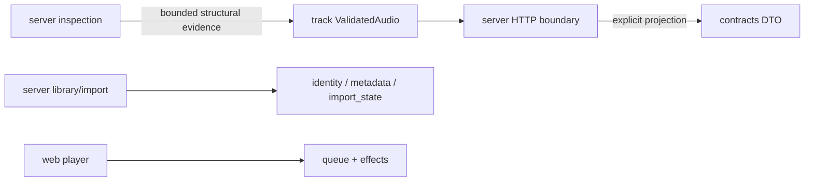

# Domain invariants

This crate has no Serde, HTTP, SQL, filesystem, browser, clock or random-number
calls. Callers generate UUIDs and pass evidence from inspection. IDs reject nil.
`ValidatedAudio::new` requires nonempty ASC, samples and positive duration,
sample rate, channel count and size; sample ranges use checked addition. Inspection
still owns AAC codec validation, mdat membership, input budgets and purchase-tag
matching. This constructor cannot certify decoding or purchase ownership.

`AudioDigest` uses the task02 `rustune-aac-probe-v1` scheme. `VerifiedStoreId`
means the `itunes-tag-pattern-v1` rule matched editable tags, not authenticated
ownership. It never contains buyer/account values. `reconcile_identity` rejects
different tracks or different audio digests, even when the store ID matches.
Deleting/deleted matches are excluded. A persisted explicit exclusion must also
be checked by the importing service before publishing or retrying.

Metadata values are trimmed validated Unicode scalar sequences. Resolution keeps
manual > explicitly enriched > imported > fallback. Clear removes an override;
rescan updates only the imported layer. `album_key` releases store grouping for a
manual album/album-artist change. Services persist that release, so clearing a
manual override does not silently restore a stale store grouping. Search alone
uses NFKC/lowercase; display values retain their original text.

Import transition functions reject transitions from terminal states; retries
create new jobs/items. Progress construction checks sum overflow and totals.
The service remains responsible for atomically recording one terminal outcome
per item and incrementing its aggregate counters once.

Queues identify occurrences by entry ID, permit repeated tracks and reject
duplicate entry IDs without mutation. Next at the end stops; Previous at the
beginning stays there. Removing a current track selects the next remaining entry
after it, otherwise stops. Effects describe intent; the web layer executes browser
audio calls and treats audio events as the playback-state authority.

