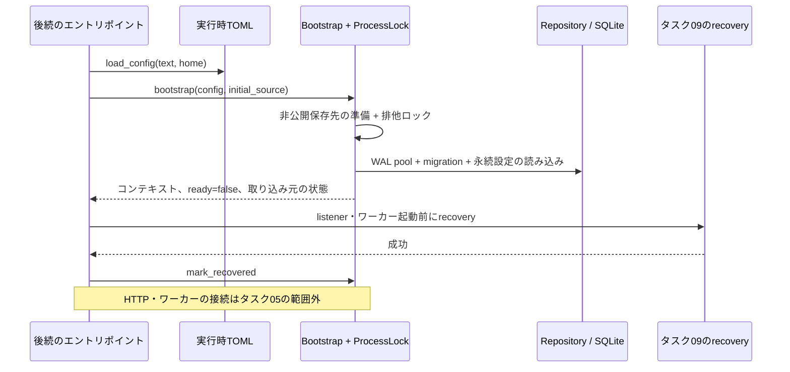

# 永続化と起動の境界

`Repository::open`はSQLiteを作成・migrationし、WAL、外部キー有効、synchronous=FULL、
busy timeout 5秒、接続数上限4で開く。SQLは動的クエリであり、ビルド時のDBやSQLxの
offlineキャッシュは不要。初期スキーマは`migrations/0001_library.sql`が所有する。
リリース済みのmigrationは書き換えず、後続のmigrationを追加する。

内部の行データや取り込み元パスのOSバイト列はAPIレスポンスへSerializeしない。
Repositoryへ渡す時刻はサーバーが生成するUTCのRFC 3339文字列とする。公開revisionは
u64で、SQLiteには非負のi64として保存し、オーバーフロー時は折り返さず拒否する。

提供するRepository操作は、戻る前に必ずcommitまたはrollbackを完了する。取り込み予約は
並行したスキャン要求を1件へまとめる。設定のroot変更は、現在値を読む前に書き込み
ロックを取得し、revisionのCASと実行中importが無いことを確認したうえで、過去の
source rootを保持する。自動取り込みの無効化は既存jobに影響しない。プレイリストの
変更と表示に影響する設定変更は、同じtransaction内でlibrary revisionを増やす。CASの
失敗やrevision加算の失敗では、すべての書き込みをrollbackする。

取り込みの確定・復旧とライブラリサービスの操作はタスク09/10で追加する。trackの予約・
確定、識別子の対応付け、メタデータ更新、プレイリスト項目の並べ替え、お気に入り、
削除・除外のtransactionも同じpool・スキーマを使う。それらのDB transactionを
コピー、rename、画像処理、外部通信の間に保持し続けてはならない。`pool()`はSQLを扱う
サービスとテストのためのものであり、ファイル操作アダプタへtransactionを漏らす用途ではない。

`config::load_config(text, home)`はTOMLの運用設定だけを検証する。対象はloopbackの
bind先、0以外のport、データ保存先、Web資産、ログフィルタ。取り込みroot、自動取り込み、
間隔、ファイルサイズ・空き容量の上限、storefrontはDB設定だけが所有する。既定値は
新規DBにだけ挿入する。`data_dir`・`web_dist`は明示指定・既定値とも絶対パスに限り、
相対パスや親ディレクトリへの移動（`..`）を含むパスは拒否する。

`web_dist`の既定値は、DESIGN_DOCの「Trunkで生成した静的資産をRustサーバーと同じ
リリースディレクトリに配置する」方針に合わせ、実行ファイルのディレクトリを基準にした
絶対パス`<実行ファイルのディレクトリ>/web`とする（`load_config`が`current_exe()`を
実パスへ解決して求める。基準を明示する場合は`load_config_with_release_dir`）。
起動時の作業ディレクトリには依存しない。開発時（`cargo run`、バイナリは`target/`配下）は
この既定値に資産が無いため、TOMLで`web_dist = "<リポジトリの絶対パス>/crates/web/dist"`を
明示する。相対パスの既定値を開発用の例外として残すことはしない。現行`main.rs`の
`RUSTUNE_WEB_DIST`による仮の既定値は、タスク11でこの設定読み込みへ置き換える。

取り込み元と保存先の重なりは`config::root_relation`で判定する。各パスについて、解決
できる最も深い祖先を`canonicalize`し、残りの成分を後ろに足してから構成要素単位で比較する。
これにより、途中の祖先が存在しない・読めない場合でもシンボリックリンク別名を保ったまま
比較できる（例：`/alias -> /data`、`/data/private`が読めない、取り込み元
`/alias/private/music`・保存先`/data`は重なりと判定する）。結果は次の3種類。

- `Separate`：最後まで解決でき、包含関係がない。
- `Overlapping`：解決後のパスで一方が他方を含む。読めない部分を含む場合も安全側で重なりとする。
- `Unverifiable`：読めない祖先の下に別名が隠れている可能性があり、分離を確認できない。

設定変更などで使う`validate_separate_roots`は`Separate`だけを受け付け、`Unverifiable`は
`UnverifiableRoots`として拒否する（確認できない包含関係を分離済みとは扱わない）。起動時の
`reject_overlapping_roots`は`Overlapping`だけを起動失敗とする。`Unverifiable`な取り込み元は
そもそも読めず取り込みもできないため、起動は続けて`inspect_source_root`の状態
（`PermissionDenied`等）として報告する。これにより、実際に別の場所にある読めない取り込み元
でもHTTPは起動し、設定画面から修正できる。取り込み元rootの不在・読み取り不可は状態として
報告し、起動失敗にはしない。実際の取り込み時のno-followなdescriptorアクセスと、識別・
包含関係の再検証はタスク06が担う。

`bootstrap(config, initial_source)`は非公開の保存先を作成し、コンテキストが生きている
間は非ブロッキングのadvisoryプロセスロックを保持してから、DBを開いてmigrationし、
永続化された設定を読み込む。ロックファイルは意図的に削除しない。クラッシュ後でも
OSがロックを解放するため、残ったファイルは無害である。この関数はMusicのファイル、
LaunchAgent、ネットワークlistener、ワーカーを作成しない。`ready()`は、タスク09が
実際のrecovery後に`mark_recovered()`を呼ぶまでfalseのままとなる。アプリケーションの
エントリポイントへの接続はタスク05では意図的に行わない。

`Shutdown`は全ワーカーへ協調キャンセルを要求し、最大10秒（`SHUTDOWN_DRAIN_TIMEOUT`）
完了を待つ。HTTP・オーケストレーター側の統合では、まず新規予約とschedulerの定期実行を
止め、ワーカーのキャンセルを要求して完了を待ち、その後poolを閉じてプロセスロックを解放する。
タイムアウトは次回起動時のrecoveryで処理すべき作業が残っていることを意味し、確定処理が
成功したことは意味しない。`ShutdownSignal::install()`は準備完了の報告前にSIGTERM/SIGINTの
ハンドラを登録し、`recv()`でいずれかを待つ。`shutdown_signal()`はこの2つをまとめた関数。

検証には一時ファイルと合成した行データだけを使う。テストはmigration後の再オープン、
制約、transaction途中の失敗によるrollback、並行CAS、並行した取り込み要求、root設定、
保存先・取り込み元の可用性、別プロセスに対するプロセスロック（クラッシュ後の解放を含む）、
drainのタイムアウト、設定更新の並行CAS、web_distの絶対パス検証、
別名・読めない祖先を含むrootの重なり判定、独立した子プロセスでのSIGTERM受信を確認する。
購入音源は不要。
