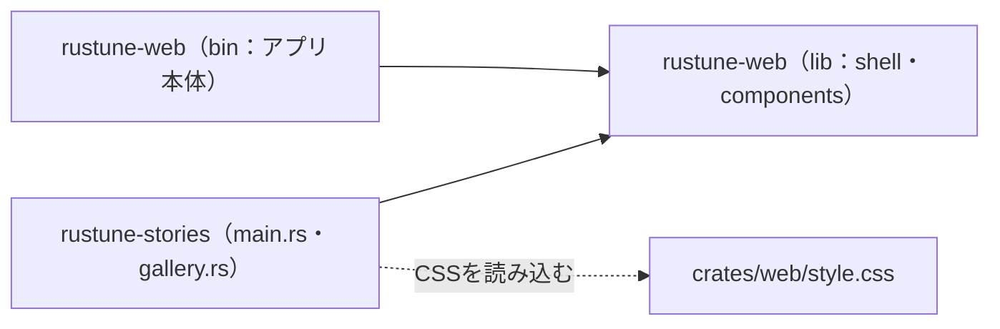

# Rustune UIギャラリー（開発専用）

Storybookの代わりに、共有CSSトークン・共通部品・各画面を一覧できるページ。アプリ本体（`rustune-web`）とは別のcrateなので、ギャラリーのコードはアプリの成果物やserverの配信物に含まれない。

## 起動

リポジトリルートで次を実行する（[mise](https://mise.jdx.dev/)のタスク。定義はルートの`mise.toml`）。

```sh
mise run gallery
```

初回は`mise trust`でルートの`mise.toml`を信頼する必要がある。miseを使わない場合は`cd crates/stories && trunk serve`でも同じ。

`http://127.0.0.1:8081/gallery`を開く。portはアプリ本体（`crates/web`の8080）と同時に起動できるよう分けている。

## 表示内容

- 配色・タイポグラフィ・角丸・影：共有CSSトークン（`crates/web/style.css`の`:root`）の見本
- 共通部品：Button、リンク、再生コントロール、ナビゲーション項目、TextField、ErrorNotice、Dialog、EmptyStateを状態ごとに表示
- 画面プレビュー：各routeを390px（実寸）と1280px（50%縮小）のiframeで並べて表示

## 構成



- `src/main.rs`：URLが`/gallery`で始まればギャラリーを、それ以外ならアプリ本体の画面（`AppShell`）を描画する。画面プレビューのiframeは後者を読み込む。
- `src/gallery.rs`：ギャラリーの画面。部品は`rustune_web::components`から使う。
- `gallery.css`：ギャラリー専用のスタイル。アプリの`style.css`には足さない。
- `index.html`：アプリと同じ`../web/style.css`とアイコンを読み込む。

部品を追加・変更したら、`gallery.rs`にも見本を追加する。

## 検証

```sh
# リポジトリルートから
cargo clippy -p rustune-web -p rustune-stories --target wasm32-unknown-unknown -- -D warnings
```
