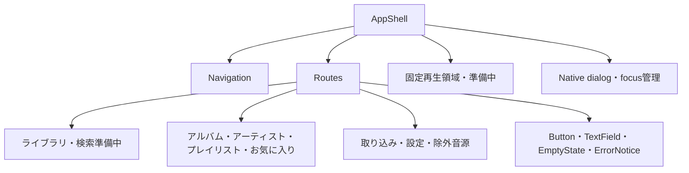

# Rustune UI基盤

`design.md`の全文に基づき、near-black面、緑の操作色、14px/16px/24pxの文字階層、pill/circle形状、共有CSSトークンを使う。専有フォント・Spotifyロゴは使わない。

`AppShell`は画面遷移を通してnavigation・固定再生領域を保持する。`leptos_router`がURL/historyを管理し、全画面へアプリ内リンクで移動できる。各routeは現在のところ準備中の表示で、業務API・音声再生・PlayerControllerは後続タスクが担当する。設定画面のhealth接続確認のみ既存基盤の機能を維持する。



`/library`、`/albums`、`/artists`、`/playlists`、`/favorites`、`/imports`、`/settings`、`/exclusions`をnavigationから開く。設計上の詳細URL `/albums/:key`、`/artists/:key`、`/playlists/:id`と未知URLにも戻り先を用意する。画面変更時にtitleを更新し、h1へfocusを移す。リンク・ボタンのfocusを白いoutlineで表示する。native `<dialog>` は `showModal()` を使い、背景をinertにする。Tab/Shift+Tabの境界は明示的に循環させ、Escape/閉じるで元のボタンへ戻す。

895px以下ではsidebarを隠し、全8項目を2行の下部navigationへ移す。再生領域はその上に固定し、mainの下部余白で重なりを防ぐ。390pxでも主要な画面を追加menuなしで移動できるよう、この2行はガイドの一般的なbottom-barからの具体化としている。focusは暗色outline例よりアクセシビリティを優先する。

Manifestと自作192px/512pxアイコンはタスク03の検証済み資産を再利用。Trunkのcopy-fileでURLを固定し、Service Workerは追加しない。`manifest.webmanifest`の配信MIMEは本番サーバー側でも `application/manifest+json` を確認する。外部リンクは信頼した固定URLに限定し `target="_blank" rel="noopener noreferrer"` を使用する。インストール後のOS挙動はタスク03のChrome実機検証に依存する。

## UIギャラリー（開発専用）

Storybookの代わりに、共通部品とトークンを一覧できる`/gallery`を用意している。`crates/web`で`trunk serve`を実行し、`http://127.0.0.1:8080/gallery`を開く。

- 配色・タイポグラフィ・角丸・影：共有CSSトークンの見本
- 共通部品：Button、リンク、再生コントロール、ナビゲーション項目、TextField、ErrorNotice、Dialog、EmptyStateを状態ごとに表示
- 画面プレビュー：各routeを390px（実寸）と1280px（50%縮小）のiframeで並べて表示

`src/gallery.rs`は`debug_assertions`有効時だけコンパイルされるため、`trunk build --release`の成果物には含まれない。部品を追加・変更したら、ギャラリーにも見本を追加する。

検証コマンド（リポジトリルートから）:

```sh
cargo fmt --all -- --check
cargo clippy -p rustune-web --target wasm32-unknown-unknown -- -D warnings
# crates/web で実行
env -u NO_COLOR trunk build --release --locked
# playwright導入済み環境からモジュールパスを指定。ブラウザは独立した一時profileを使う。
PLAYWRIGHT_PATH=/path/to/playwright/index.mjs node crates/web/tests/shell-check.mjs
```

テストは静的成果物を一時portで配信し、health APIに成功/失敗fixtureを返す。Chromeで幅390/1280、Enterによる全navigation、title/h1 focus、固定再生領域の存続、dialogのTab/Escape/閉じる・focus復帰、healthエラー復帰、詳細URL・未知URL、ManifestとPNG寸法を検証する。音声・実業務APIは検証対象に含まれない。画像はGit対象外の`.local/screenshots/`へ出力する。

2026-10-18検証結果: Rust 1.99.1、Trunk 0.21.14でformat・WASM Clippy（警告をエラー扱い）・release build成功。macOS上のChrome 155.0.8059.80で上記390px/1280pxの操作検証成功、両幅のスクリーンショットを目視確認。接続確認は成功・失敗・再成功を確認した。in-app browser接続がsandboxPolicy欠落で使用できなかったため、独立したChrome一時profileで実施した。
