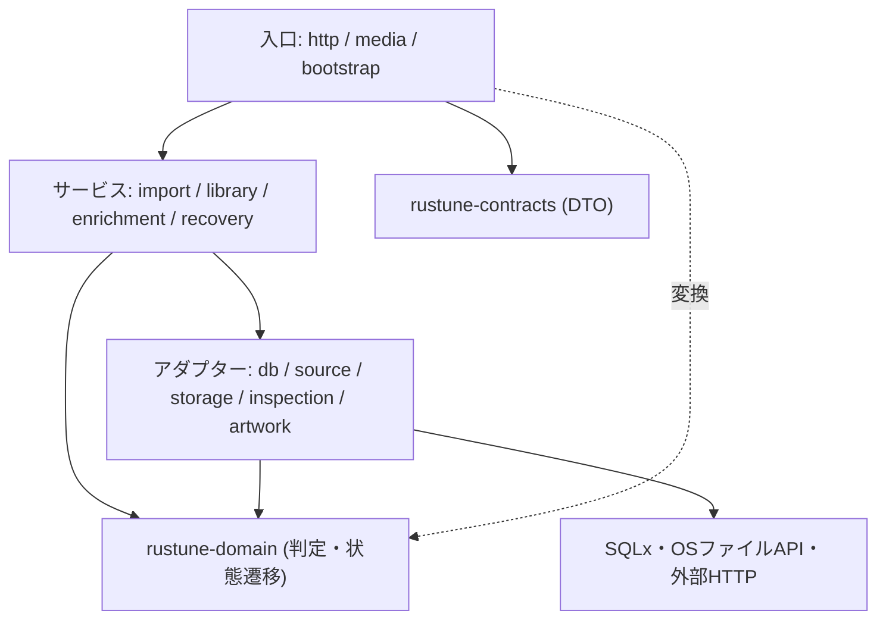

# 責務分離の規約

現状のコードは、設計書どおりのcrate・モジュール境界は守れている。一方で、1つのモジュールや関数に複数の責務が詰め込まれている箇所が多い。以後は本書の基準で、より細かく分離する。

> 原則：**1つのモジュール・型・関数は、変更する理由を1つだけ持つ。** 「判定」「I/O」「変換」「組み立て（オーケストレーション）」「表示」を同じ単位に混ぜない。

## 1. レイヤーと依存方向

crate間の依存方向は`MODULE_DESIGN.md` §1のとおり（`server/web → domain`、`server/web → contracts`、domain・contractsは他に依存しない）。そのうえで、`rustune-server`の内部を次の層に分ける。

| 層 | 責務 | 置き場所の例 | 持ってはいけないもの |
| --- | --- | --- | --- |
| 入口（HTTP・起動） | リクエストの解析、`validate()`、サービス呼び出し、DTO・ステータスへの変換 | `http`、`media`、`bootstrap`、`main.rs` | SQL、ファイル操作、業務判定 |
| サービス（ユースケース） | 1つのユースケースの手順の組み立て、トランザクションの区切り | `import`、`library`、`enrichment`、`recovery` | axumの型、SQL文、OS API |
| ドメイン | 不変条件、判定、状態遷移（純粋関数） | `rustune-domain` | I/O全般、Serde |
| アダプター | DB・ファイル・外部APIへの具体的なアクセス | `db`、`source`、`storage`、`inspection`、`artwork` | 他のアダプターの呼び出し、ユースケース判断 |
| 変換 | domain型とDTO・DB行の相互変換 | 各層の`convert.rs` / `dto.rs` / `row.rs` | 判定・I/O |



矢印は「呼び出す側 → 呼び出される側」。

- アダプター同士は互いを呼ばない。組み合わせはサービスが行う（例：`storage`が`db`を呼ばない。`server::storage`のモジュールdocの「DBトランザクションとジョブ管理は扱わない」を全アダプターで守る）。
- 入口の層は薄く保つ。ハンドラーは「解析 → `validate()` → サービス呼び出し → 変換」の4段だけにする。
- 判定はできる限りdomainの純粋関数にし、サービスはその結果（`IdentityDecision`、`QueueEffect`など）に従ってI/Oを実行する。「判定してからI/O」の形を保つ。
- 差し替え可能なtraitは、障害注入が必要な境界（ファイルI/O、時計、外部通信）だけに作る（`StorageIo`）。テストのためだけに全サービスをtrait化しない（`MODULE_DESIGN.md` §1）。

## 2. モジュール内のファイル分割

設計書の1モジュールが複数の責務を持つ場合、ディレクトリにしてファイルを分ける。標準の分け方：

```text
server/src/<module>/
├── mod.rs        // //! 契約、mod宣言、pub use だけ。ロジックを置かない
├── error.rs      // <Module>Error、Display/Error/From、error_code/retryable
├── types.rs      // 公開する値型（ID、Limits、Fingerprintなど）
├── <操作>.rs     // 1つの操作群ごとに1ファイル（copy.rs、promote.rs、remove.rs など）
├── io.rs         // 差し替え可能なI/O境界（必要な場合だけ）
└── tests.rs      // ユニットテスト（#[cfg(test)] mod tests;）
```

- `mod.rs`に実装を書かない。モジュールの契約（`//!`）、`mod`宣言、`pub use`だけにする。
- エラー型とその変換（`From`、`error_code`、`retryable`）は`error.rs`に分ける。
- 値型と、それを使う処理を分ける。パスの組み立て・名前のparseのような純粋な変換は、I/Oを行うファイルから切り出す。
- DBは集約（テーブル群）ごとにファイルを分ける：`db/settings.rs`（既存）にならい、`db/playlists.rs`、`db/imports.rs`、`db/tracks.rs`、`db/exclusions.rs`のようにする。`Repository`に全集約のメソッドを並べない。SQL文字列は、そのSQLを実行する関数と同じファイルに置く。
- DB行の構造体（`*Row`）と、domain型への変換は`db/<集約>/row.rs`または同じファイルの非公開部分に置き、`db`の外へ出さない。

## 3. 関数の分割

- 1つの関数は1段階の抽象度で書く。手順を並べる関数（オーケストレーション）と、1手順の中身を書く関数を分ける。
- 「検査 → 読み取り → 計算 → 書き込み」のように段階がある処理は、段階ごとに関数を分け、段階の結果を型で受け渡す（`Staging` → `StagedFile`の考え方を関数単位にも適用する）。
- 純粋な判定・計算は、I/Oを行う関数から引数と戻り値だけの関数として切り出し、単体でテストする。
- 似た`match`・`if`の連なり（`SettingsPatch::validate`の長い`||`連鎖など）は、項目ごとの検証関数に分ける。
- 引数が4つを超える、または`bool`引数が2つ以上ある関数は、引数をまとめる構造体かenumを検討する（`album_key(…, store_group_released: bool, compilation: bool)`など）。

## 4. サイズの目安

厳密な上限ではなく、分割を検討し始める目安。超える場合はレビューで理由を説明する。

| 単位 | 目安 |
| --- | --- |
| 1ファイル（テストを除く） | 300行 |
| 1関数 | 50行 |
| 1つの`impl`ブロックの公開メソッド | 10個 |
| 1つの`#[component]` | `view!`を含めて80行 |

## 5. crate別の分離方針

### domain

- `track.rs`のように、ID・値型・状態遷移が1ファイルに同居している場合は分ける。例：`track/{id.rs, audio.rs, state.rs}`。ID生成マクロ`id!`は`track`専用ではないので`id.rs`へ移す。
- `metadata.rs`は「値型（`Text`・`TrackNumber`）」「優先順位の解決（`resolve_metadata`）」「検索の正規化（`normalize_search`）」「アルバムのまとめ方（`album_key`）」の4つの責務を持つ。ファイルを分ける。
- fallback文字列（`"不明なアーティスト"`など）は定数にまとめる。

### contracts

- `lib.rs`には`pub mod`と最小限の再exportだけを置く。`Patch<T>`は`patch.rs`、`validate_text`・`validate_number`は`validation.rs`、`Pagination`・`Page`は`pagination.rs`、`HealthResponse`は`health.rs`に分ける。
- リクエストDTOとレスポンスDTOが同じファイルで増えてきたら、`<領域>/request.rs`・`<領域>/response.rs`に分ける。

### server

ブランチ上の実装で、分割の対象になる例：

| 現状 | 混在している責務 | 分け方の例 |
| --- | --- | --- |
| `storage/mod.rs`（約730行） | 定数・値型・パス組み立て・エラー・staging・コピー・確定・削除・列挙 | `error.rs`、`types.rs`、`managed_file.rs`（パス組み立てとparse）、`staging.rs`、`copy.rs`、`promote.rs`、`remove.rs`、`list.rs` |
| `inspection/mod.rs`の`inspect_inner`（約150行） | box境界の検査、トラック解析、購入タグ照合、メタデータ抽出、digest計算 | `MODULE_DESIGN.md` §7の処理順ごとに関数・ファイルを分ける：`container.rs`、`track.rs`、`purchase.rs`、`metadata.rs`、`digest.rs` |
| `source/mod.rs` | エラー、fingerprint、安全なopen、ディレクトリ走査 | `error.rs`、`fingerprint.rs`、`open.rs`、`walk.rs` |
| `bootstrap.rs` | エラー、プロセスロック、保存先ディレクトリ準備、起動手順、終了通知 | `bootstrap/{error.rs, lock.rs, storage_dirs.rs, shutdown.rs, mod.rs}` |
| `db/mod.rs`の`Repository` | 接続、revision、プレイリスト、取り込み予約 | 接続だけを`mod.rs`に残し、集約ごとのファイルへ移す |
| `lib.rs`の`router` | ルーティング、静的配信、ハンドラー | `http/{routes.rs, static_files.rs, handlers/<領域>.rs}` |

### web

- 通信（`web::api`）、画面データの保持と同期（`web::sync`）、画面（`web::pages`）、共通部品（`web::components`）、枠組み（`web::shell`）を分ける（`MODULE_DESIGN.md` §14）。
- `#[component]`の中で`gloo_net`を直接呼ばない。通信は`web::api`の関数にし、componentはその結果を表示するだけにする（`main`の`App`は通信と表示が同居しているので直す対象）。
- `shell/mod.rs`のナビゲーション定義（`NAV`）・タイトル決定（`title_for_path`）・レイアウトは、データ・純粋関数・componentに分ける。
- 再生は`web::player`（`PlayerController`）、OS連携は`web::media_session`に分け、キューの判断は`domain::queue`に任せる（`MODULE_DESIGN.md` §15）。

## 6. 進め方

- 新しいコードは最初から本書の分け方で書く。
- 既存コードは、そのファイルを機能変更で触るタスクの中で分割する。分割だけを行う場合は、機能変更と別のコミット（`refactor:`）にし、振る舞いを変えないことをテストで確認する。
- 実行中のタスクブランチ（タスク05〜08）の分割は、そのタスクのレビューで判断する。マージ済みのコードを一括で書き換えるタスクは、必要になった時点で別タスクとして起こす。
- 複数モジュールにまたがる分割を行ったら、`AGENTS.md`の規則どおり対応するMermaid図（crateの`README.md`、`MODULE_DESIGN.md`）を更新する。
