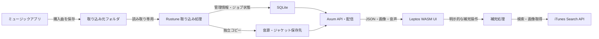

# First Build Design — Rustune

Status: Approved
Approved: 2026-10-16 by user
Last updated: 2026-10-18
Project: 20261012-214613-personal-music-library
PRD: ./PRD.md

## Design summary

同じMacで動くRustサーバーがミュージックアプリの購入曲を読み取り専用でスキャンし、独立した保存先へコピーする。Rust/WASMのSPAからライブラリを操作し、音声はブラウザ標準の再生機能へ渡す。Chromeでインストールしたウィンドウと通常のブラウザは同じWebアプリを使う。

推奨構成は **Leptos CSR + Axum/Tokio + SQLite/SQLx + ローカルファイル保存**。初期版は単一プロセスで、HTTPサーバーと取り込みワーカーを動かす。UIの描画・状態管理・再生キューはRust、DOM・音声再生・Media Sessionとの接続はweb-sysを使う。

本書は承認済みPRDを基にした設計提案。技術選定も本書のレビュー対象とする。実装計画・製品コードはまだ作成しない。購入曲判定、Chromeインストール挙動、ジャケット補完には未検証事項があり、後述の検証ゲートで確定する。

## Technology choices

| Area | Choice | Rationale | Alternatives considered |
| --- | --- | --- | --- |
| UI | Leptos、leptos_router、CSR | Rustでリアクティブな画面と状態を構築。個人用アプリではSEOやSSRを必要としない | Yewも成立する。Dioxusのマルチプラットフォーム展開は今回の範囲に不要。ReactはRust中心の方針に合わない |
| Webビルド | Trunk、wasm-bindgen、web-sys、CSS | CSRを静的配信でき、RustからブラウザAPIを利用できる | SSR用の構成は初期版には追加しない |
| サーバー | Axum、Tokio、tower-http、Serde | 型付きJSON API、非同期I/O、音声ファイル配信を同一プロセスで構成 | Actix Webも可能。既存コードがないためTokio周辺に統一 |
| データ | SQLite、SQLx、SQL migrations | 単一ユーザー・単一Macで運用しやすく、取り込み状態と管理情報をトランザクションで更新できる | PostgreSQLは別サービスの運用が必要。音源BLOB保存はバックアップと配信を複雑にする |
| 音源 | アプリ専用フォルダ内の通常ファイル | 元音源と独立し、HTTP Rangeで配信できる | 元音源の直接参照・ハードリンクは独立性を満たさない |
| タグ | mp4ameta、専用の形式検証境界 | AAC/M4AタグをRustから読む。タグ取得とAAC構造検証を分離 | 汎用タグライブラリは対応形式が増えた時点で再評価 |
| 取り込み | 定期走査 + 永続ジョブ、逐次コピー | 起動中・停止中の追加を同じ経路で扱え、ファイル監視イベントの欠落に依存しない | notifyによる監視は将来の高速化候補。初期版は1分間隔の走査 |
| 画像 | imageによるサイズ制限付きデコード・サムネイル生成 | 巨大画像のメモリ消費を制限し、一覧表示を軽くする | 埋め込み画像を毎回そのまま配信する方式は避ける |
| 補完 | reqwest + iTunes Search APIアダプター | タイムアウト・呼び出し上限・候補変換を一か所で扱う | MusicKitはPRD対象外 |
| 運用 | tracing、TOML設定、ユーザーLaunchAgent | ログイン時起動と異常終了後の再起動をMac標準機構で扱う | Dockerはメディアフォルダ権限とログイン起動が複雑になる |

Leptos公式はCSRとTrunkの構成を案内している。[Leptos Getting Started](https://book.leptos.dev/getting_started/index.html)。AxumとTowerの統合は[Axum middleware](https://docs.rs/axum/latest/axum/middleware/)を参照。依存バージョンは実装開始時に相互互換な安定版を選び、Cargo.lockとrust-toolchain.tomlで固定する。本書では未確認の最新版番号を指定しない。

## System context

既存リポジトリにはPRDとPROJECT.mdのみあり、再利用するアプリコード・DB・移行対象はない。音源はユーザーのMusicライブラリにあり、アプリのソースツリー外に保存する。

データの流れは、ミュージックアプリ → 読み取り専用の取り込み元 → Rustuneの検証・コピー → ライブラリ保存先とSQLite → HTTP配信 → ブラウザ。外部ネットワークはユーザー操作時のメタデータ補完にのみ使用し、通常の取り込み・検索・再生では不要。

以下は実行時のデータの流れ。クレートのコンパイル依存とは区別する。

初期運用は同じMacの`http://localhost:3867`に固定し、サーバーはloopbackだけにbindする。ポートは設定可能だが、変更時にはChrome側のインストール先も変わることを案内する。私設ネットワークへの公開は既定構成に含めない。

## Architecture and component boundaries

モジュールごとの公開境界、データ制約、エラー、状態遷移と復旧は[モジュール詳細設計](./MODULE_DESIGN.md)に記載する。両書を設計レビューの対象とし、詳細化した契約は同書を参照する。

Cargo workspaceは次の4単位とする。DBの型や外部APIの生レスポンスはフロントへ共有しない。

| Component | Responsibility | Dependencies |
| --- | --- | --- |
| `crates/contracts` | APIの要求・応答、ID、公開エラーコード | Serde。出所の相対パスと設定画面用の取り込み元以外のファイルパス、購入者タグを含まない |
| `crates/domain` | ドメインの実体・ID・不変条件、重複判定、状態遷移、メタデータ優先順位、キューの純粋ロジック | HTTP/UIを知らないRustコード |
| `crates/server` | API、SQLite、走査・検証・コピー、音源配信、外部API、設定、ログ | domain、contracts、OSとストレージ |
| `crates/web` | Leptos画面、APIクライアント、プレイヤー、Media Session | domainのキュー部分、contracts、web-sys |

server内は`library`、`import`、`storage`、`media`、`enrichment`のモジュールに分ける。独立サービスや汎用プラグイン基盤にはしない。取り込みの重い解析・ハッシュ・画像処理は上限付きのblocking実行へ隔離し、HTTP処理の実行スレッドを塞がない。

UIはAppShell直下に永続PlayerStoreと単一のHTMLAudioElementを置き、その内側で画面を切り替える。ページ移動でaudio要素を作り直さない。画面はライブラリ、アルバム詳細、アーティスト詳細、プレイリスト、お気に入り、取り込み履歴、設定・除外一覧。狭い画面でもナビゲーションと再生バーを利用可能にする。

## Data model and state

| Entity | Main fields / rules |
| --- | --- |
| tracks | UUID、状態`staging/ready/deleting/deleted/error`、保存相対パス、サイズ、ファイルハッシュ、音声ハッシュ、ストア楽曲ID、再生時間、created_at |
| track_metadata | 取り込み時の許可項目、API補完値、手動編集値を分離。表示は手動 > 承認済み補完 > 埋め込み > 代替表示 |
| sources | source root ID、相対パス、ファイル識別情報、サイズ・mtime、最終確認、track ID。1曲に複数の出所を許す |
| identities | 識別方式と値にUNIQUE制約。ストアIDまたは音声ハッシュを曲・削除記録へ対応付ける |
| import_jobs / import_items | 手動・起動時・定期の種別、状態、総数、処理済み、追加・スキップ・失敗件数、項目ごとの理由、再試行可否 |
| playlists / playlist_items | UUID、名前、revision、曲ID、position。同じ曲の複数追加を許す。並べ替えは全体を1トランザクションで更新 |
| favorites | track IDを主キーとする |
| exclusions | 削除した曲の識別子、日時。音源本体を削除した後も保持し、解除できる |
| artwork | ID、由来、保存先、サイズ、外部出典・ストアリンク。画像は別ファイル |
| settings | 取り込み元、auto_import、走査間隔、容量制限、storefront。OS起動設定とbind先はTOML |

アルバム・アーティストは初期版ではメタデータから集計したビューとして扱う。アルバムはストアのアルバムIDがあれば利用し、なければアルバム名とアルバムアーティストでまとめる。後者欠落時はcompilation情報または曲アーティストへフォールバックする。誤ったグループはメタデータ編集で修正する。ディスク番号・曲番号・タイトル・IDの順に安定ソートする。

検索は表示値から生成したUnicode正規化済み検索列の部分一致。SQLパラメーターを使い、`%`と`_`は文字として扱う。1万曲ではまずページング付き検索を測定し、FTS等の追加は必要な場合だけ検討する。日本語の部分一致を英語用トークン分割に依存させない。

SQLiteはWAL、foreign_keys有効、busy timeout、短い書き込みトランザクションとし、ファイルコピー中にDBトランザクションを保持しない。WALでも書き込みは直列であるため、コピーは1並列、更新は短時間に限定する。[SQLite WAL](https://sqlite.org/wal.html)

## Interfaces and integrations

### HTTP API

同一originの`/api/v1`にJSON APIを置く。エラーは`{code, message, retryable, request_id}`。一覧は上限100件のページング、変更にはrevisionを使い、競合は409。入力不正400、対象なし404、容量不足等は識別可能なcodeを付ける。

| Endpoint | Contract |
| --- | --- |
| POST /imports | 202とjob ID。実行中なら既存job IDを返す。入力として任意のファイルパスを受け取らない |
| GET /imports、/imports/:id、/imports/:id/items | 状態、集計、ページングした結果。source root配下の相対パスのみ返す |
| GET /tracks、/tracks/:id、/albums、/artists | 検索、一覧、詳細 |
| PATCH /tracks/:id | 許可されたメタデータ項目だけ更新 |
| DELETE /tracks/:id | 202と削除状態。最終削除まで成功済みと表示しない |
| GET /exclusions、DELETE /exclusions/:id | 除外一覧・解除。解除後に走査を予約 |
| POST/PATCH/DELETE /playlists、PUT /playlists/:id/items | 作成、改名、削除、順序変更。実際のID付きパスは操作対象に合わせる |
| PUT/DELETE /tracks/:id/favorite | お気に入りの冪等更新 |
| GET/PATCH /settings | 検証した取り込み設定。保存先と取り込み元の重なりは拒否 |
| POST /enrichment/search、/enrichment/apply | 候補取得と選択済み候補の反映を分離。任意URLの代理取得は不可 |
| GET/HEAD /media/:track_id、GET /artwork/:id | ready状態の音源・許可画像だけ配信 |
| GET /health/ready | DBと起動時復旧の完了状態 |

取り込み中は2秒、通常は15秒ごとに状態をポーリングし、ライブラリrevision変更時に一覧を再取得する。ウィンドウが非表示ならUIポーリングを抑え、再表示時に同期する。バックグラウンド取り込みはサーバーが継続する。初期版はWebSocket/SSEを追加しない。

### Audio / OS media controls

音源はIDからDB経由で解決し、ディレクトリを静的公開しない。`audio/mp4`、Content-Length、Range、206、416、HEADを検証する。tower-http ServeFileを使用候補とし、末尾にmoovがあるファイルも含めてシークを確認する。[ServeFile](https://docs.rs/tower-http/latest/tower_http/services/struct.ServeFile.html)

HTMLAudioElementのイベントを状態の正とし、play()の拒否、error、ended、durationchangeを処理する。ユーザー操作後に再生し、Macログインやページ表示だけでは自動再生しない。PRDの「再起動後に手動操作なし」はサーバー起動作業が不要という解釈であり、再生ボタン操作は必要。音声全体をWASMメモリへロードしない。

Media Sessionに曲情報と同一originのジャケットを設定し、play/pause/previoustrack/nexttrack/seektoをPlayerStoreと接続する。UIとOSから同じ操作関数を呼び出す。MacのChromeをOS操作の必須検証対象とし、通常画面の再生はSafari・Firefoxでも確認する。[Chrome Media Session](https://developer.chrome.com/blog/media-session?hl=en)

キューはブラウザウィンドウ単位で管理し、曲削除のrevision検知時に参照を除去する。複数ウィンドウ間の再生同期やキュー永続化は初期版の保証に含めない。

### iTunes metadata enrichment

ユーザー操作でのみ呼び出し、候補のタイトル・アーティスト・アルバム・ストアリンクを表示する。候補選択時に適用する項目を明示し、既存の手動編集を黙って上書きしない。全体で最低3.1秒の呼び出し間隔、429の待機、10秒タイムアウト、件数上限20。失敗時は既存データを保持する。previewUrlは読み取り・保存・配信しない。

重要な未確定点：Appleの公式資料にはアルバムアートを含むプロモーション用コンテンツの用途・ストアリンク等の条件がある。試聴を使わなければジャケットを無条件に利用できる、とは扱わない。[Apple Search API](https://performance-partners.apple.com/resources/documentation/itunes-store-web-service-search-api/)

さらに公開レスポンス資料ではartworkUrl60/100が示され、高解像度版を保証する契約は確認できていない。URLの数値を書き換えて高解像度取得を保証する設計にはしない。[Apple Search Results](https://developer.apple.com/library/archive/documentation/AudioVideo/Conceptual/iTuneSearchAPI/UnderstandingSearchResults.html)

ユーザー承認によりREQ-013はAPIが返す低解像度画像を許容する要件へ変更した。埋め込みジャケットを優先し、欠落時は返された画像URLで補完する。既存画像の置換は候補選択と明示的な適用操作で行う。画像は縦横比を保って表示し、高精細に見えることは保証しない。画像URLがなければ既存画像または既定画像を保持する。解像度を理由に補完機能を延期しない。利用条件の検証は別途必要であり、満たせない場合にのみ要件変更・延期をレビューする。

## Critical flows

### 1. 自動検出と安定待ち

起動時に走査し、以降は既定60秒間隔で実施する。手動と自動は同じジョブ実装を使い、同時に複数走査しない。走査要求は合流させる。auto_import=falseなら起動時・定期走査とも停止し、手動操作は残す。

列挙中は総数未確定と表示し、候補リスト確定後は総数と処理件数を表示する。候補のサイズ・mtime・ファイル識別情報が10秒以上離れた2回の観測で一致した後に解析する。コピー前後にも比較し、変化したファイルは破棄・再試行する。安定しただけでダウンロード完了とは断定せず、コンテナ全体の構造とサンプル範囲の妥当性も検証する。

少数追加の通常時はファイル書き込み完了から90秒以内の取り込み開始を目標とする。Macスリープ中と大量の待ち行列は除き、起床後は再走査する。未完了らしい解析失敗は次回へ回し、10分間安定しても不正なら破損として結果に残す。その後ファイルが変われば再試行対象へ戻す。

### 2. 購入曲・形式・重複の判定

拡張子は候補抽出に使い、最終判断は内容で行う。対象は`.m4a`で、単一の対応AAC音声トラック、サンプルテーブル、サンプル範囲を検証する。ALACや解釈不能な構造は未対応形式として扱う。再生可否はブラウザのaudio要素で確認し、再生できなければエラーを表示する。暗号化・保護構造を調査する専用判定は実装しない。

mp4ametaは許可したタグの取得に用い、購入済み判定ができるとは仮定しない。[mp4ameta Tag](https://docs.rs/mp4ameta/latest/mp4ameta/struct.Tag.html)。購入由来の識別候補としてストア楽曲IDや購入関連タグを調査するが、確実な公開仕様が確認できていないため、匿名化した実ファイルでルールを検証する。購入者メール等の値を保存する必要はない。判定不能は`purchase_unverified`として除外し、CD由来AACを購入曲として扱わない。これは購入証明・権利認証の仕組みではない。

重複は検証済みストア楽曲IDを優先し、欠落時にはコンテナのタグ領域を除いたAACサンプル列とデコーダ設定のハッシュを使う。タイトルの一致だけでは統合しない。ファイル全体のハッシュはコピー整合性に使用する。REQ-004は同じフォルダの再スキャンと同じ音源ファイルの別パスコピーを検証対象とする。配布元から取得し直した音源の同一性を保証するための実データ比較ゲートは設けない。

### 3. コピーと公開

1. 上限200 MiB、現在の空き容量がコピー予定サイズ + 1 GiB以上であることを確認する。コピー中も容量と読み出し量の上限を確認する。
2. 安全に開いた元ファイルを読み取り、専用保存先のstagingへコピーする。実行中の元ファイルの変化を検知する。元には書き込まない。
3. コピー先を検証し、タグ・画像・識別子を得る。重複・除外なら一時ファイルを除去してスキップ理由を残す。
4. DBへstaging状態と最終保存先を記録。ファイルをflush/syncし、同じファイルシステム内で最終名へrenameする。
5. DBトランザクションでready、出所、メタデータ、項目結果を確定する。readyだけを検索・再生対象にする。

DBとファイルシステムは単一トランザクションではない。起動時にstaging行と実ファイルを照合し、整合が確認できれば完了、できなければ一時ファイルを回収して再取り込み可能にする。DBにない管理下の一時ファイルも回収する。元ファイルは回収対象にしない。

### 4. 削除・除外解除

DBで除外識別子を登録してdeletingにし、一覧と新規配信から外す。同時にプレイリスト・お気に入り参照を更新し、ライブラリrevisionを増やす。アプリ管理下のコピーを削除できたらdeletedとする。失敗時はdeletingと理由を保持して再試行できる。既存再生はクライアント同期時に停止・キュー整理する。参照中の配信ハンドルは削除処理で追跡し、必要なら終了させる。

解除操作では対象の除外識別子を取り除き、次の走査で再取り込みする。元音源がない場合は復元できないと表示する。除外記録を含めてバックアップする。

## Security and privacy

取り込み元と保存先の同一・包含関係を拒否する。シンボリックリンクはすべてたどらず、rootからのディレクトリハンドル相対アクセスとno-followで開く。検査後の差し替えも考慮し、開いたファイルの属性とroot境界を確認する。単なる文字列prefix比較は使わない。

loopback限定に加え、HostとOriginを固定許可リストで検査し、CORSを開放しない。変更APIには同一originのOriginとCSRFトークンを要求し、他サイトからlocalhostの削除・設定操作を実行させない。音源の配信先も許可originだけとし、Cross-Origin-Resource-Policyを設定する。リクエストサイズとタグ・画像展開サイズを制限する。

メタデータDTOは許可項目のみ。パーサー全体のDebug出力、Apple ID等の生タグ、外部APIの生レスポンスはログに出さない。UIとログに出す出所はroot相対パスとし、ユーザーのホームディレクトリ名を露出しない。例外メッセージも公開用codeへ変換する。

コピーした音源自体には元の購入者タグが残る。初期版は個人のloopbackへの音声配信であり、原音源を改変して匿名化する設計ではない。NFR-010のAPI応答はJSON等の管理情報を対象とする解釈で、音源のバイト列からも購入者タグを除去するという解釈なら設計変更が必要。音源を共有・公開しない。保存先は当該OSユーザーだけが読める権限にする。

補完画像を取得する場合はAPIで得た許可HTTPSホストのみを扱い、リダイレクト先と接続IPも検査する。ループバック・私設アドレスへの誘導、過大応答、非画像を拒否する。外部リンクは検証済みのストアURLだけを使う。

## Reliability and failure handling

取り込み項目は`pending → checking → copying → imported/skipped/failed`。ジョブは`queued → running → completed/failed`。一部項目の失敗でも走査が完了したならcompletedとし、失敗件数を明示する。rootへのアクセス不能等はジョブ自体をfailedにする。

再起動時にrunningだったジョブは中断としてfailedにし、一時データを照合後、新しい走査を実行する。未変更で取り込み済みのsourceはサイズ・mtime等で解析を省略できるが、不明なものはハッシュとIDを再検査する。クラウド上にしかない曲は見つからないため、「購入曲が見つからない場合はミュージックアプリでダウンロード」を常設案内する。

常時1ワーカー・1プロセスロックを維持する。重い取り込み時にも再生配信を優先する。元フォルダの権限不足はファイルなしと区別する。容量不足は後続コピーを止め、原因解消後に再実行できる。無制限の即時リトライは行わない。

## Observability and operations

JSONログにrequest ID、job ID、track ID、相対パス、処理時間、理由codeを残す。ログはローテーションし、既定は10 MiB × 5本。ジョブ履歴は直近90日、削除除外と楽曲出所は期限で消さない。UIで最終走査時刻と次回予定、失敗理由を確認できる。

保存先は`~/Library/Application Support/Rustune/`配下の`library.sqlite3`、`media/`、`artwork/`、`staging/`、`config.toml`。保存パスには曲名・購入者名を使わずUUIDを使う。設定の既定取り込み元はPRDどおりとし、初回画面で読めるか確認・変更する。

バックアップはサーバー停止、SQLite接続終了、専用データディレクトリ全体をコピーする手順を初期版に採用する。WAL稼働中のDB本体だけのコピーを案内しない。復元は同じアプリ版へデータ一式を戻して起動・整合性確認・再生する。Chromeローカルの一時キューは復元対象外。

## Testing strategy

実装の最初に以下の検証を置く。現時点では文書調査のみであり、実機・実ファイルでの確認は未実施。

1. 指定された購入済みAAC、同じ音源の別パスコピー、タグ差分、CD由来AAC、ALAC、破損・途中ファイルで形式・購入由来情報と重複を検証する。個人情報・購入音源はGitへ追加しない。CIでは合成した非機密fixtureを使い、実音源での結果は匿名化して記録する。
2. 最小Manifest付きの検証ページをMacのChromeでインストールし、インストール診断、アドレスバーのアイコン、名前、Dock、独立ウィンドウ、外部リンク、再起動後のURLを確認する。Service Workerは登録しない。title変更とインストール名を分離する。
3. AACのRange配信・シーク、末尾moov、Media Session・メディアキー・背景ウィンドウ操作を実機で確認する。
4. REQ-013は返された解像度の画像で補完・表示し、画像欠落時に既存情報を保持することを検証する。利用条件も確認し、満たせない場合はShould延期または要件修正を明示的にレビューする。

純粋ロジックの単体テスト、tempdir + SQLiteによる取り込み統合テスト、HTTP API・Rangeの結合テスト、ブラウザE2Eを分ける。障害注入はコピー・rename・DB commit・削除の各境界、元ファイル変更、root外リンク、権限、容量不足を対象にする。

macOSの実Chrome・Firefox・Safariで日本語検索、主要操作、1280px/390px、キーボード操作を確認する。Playwright WebKitだけをSafariの実機確認の代わりにしない。OS操作とChromeインストールは手動受け入れ手順を残す。

性能は4 CPU相当・8 GB・SSDのMac、1万曲の管理データ、同時1ユーザー、取り込み有無で測定する。ウォームアップ後に固定検索100回と再生開始30回のp95を記録し、検索1秒・再生2秒を満たす。使用Mac、OS、ブラウザ、音源サイズ、計測条件を記録する。性能用データは合成可能だが再生は実ファイルでも確認する。

## Deployment and rollout

Trunkで生成した静的資産をRustサーバーと同じリリースディレクトリに配置し、同一originで配信する。SPAの画面URLはindex.htmlへfallbackし、API・media・Manifest・アイコンの404にはfallbackしない。indexとManifestは再検証、ハッシュ付き資産は長期cacheとする。Service Worker、オフライン動作、Tauriは追加しない。

`<title>Rustune</title>`、favicon、192px/512pxの自作アイコン、`manifest.webmanifest`を用意する。Manifestは`name/short_name: Rustune`、`id/start_url/scope: /`、`display: standalone`、共有トークンのtheme/background colorを持ち、HTML headから参照する。取り込み元・購入者情報を含めない。Chromeの診断に加え、未インストールの実ブラウザでアイコン表示とインストールを確認する。既存インストールや利用履歴による表示差は記録する。[Chrome install criteria](https://web.dev/articles/install-criteria)

アプリ内ナビゲーションを完結させ、インストール後の画面タイトルは曲名または画面名とする。外部リンクには`target=_blank`と`rel=noopener noreferrer`を使い、通常ブラウザへ開く挙動をChrome実機で確認する。

ユーザーLaunchAgentを`~/Library/LaunchAgents/`へ配置する手順を用意する。ProgramArgumentsはバイナリ・設定の絶対パス、RunAtLoadを有効、異常終了時のKeepAliveと再起動間隔を設定する。root daemonにはしない。bootstrap/bootoutによる有効化・解除、手動起動での権限確認、ログ確認を手順化する。サーバー停止直後にChromeを開くとエラーページになる可能性があるため、health確認と再読み込みの復旧手順を記載する。[Apple launchd guide](https://developer.apple.com/library/archive/documentation/MacOSX/Conceptual/BPSystemStartup/Chapters/CreatingLaunchdJobs.html)

リリースは停止・バックアップ・バイナリ/資産更新・DB migration・再起動・health確認の順。migration失敗時は起動を止める。スキーマ変更後の旧版復帰はデータバックアップごと戻す。設計作業中にユーザーのLaunchAgentやMusicフォルダは変更しない。

## Requirement traceability

| Requirement | Design sections | Verification approach |
| --- | --- | --- |
| REQ-001 | Critical flows 1–3 | 元ファイル不変、コピー後の再生、画面終了後の継続 |
| REQ-002 | HTTP API; Reliability and failure handling | 総数・件数・理由表示、部分失敗ジョブ |
| REQ-003 | Critical flows 3; Reliability and failure handling | 各境界でプロセス停止・再起動 |
| REQ-004 | Critical flows 2; Data model and state | 再スキャン・同じ音源の別パスコピー・タグ差分 |
| REQ-005 | Data model and state | タグ欠落、編集後の再走査、複数ディスク |
| REQ-006 | Data model and state; Architecture and component boundaries | 日本語部分一致、空状態、ページング |
| REQ-007 | Audio / OS media controls | 実ブラウザの再生・シーク・画面遷移 |
| REQ-008 | Audio / OS media controls | ended、前後移動、キュー追加・削除 |
| REQ-009 | Data model and state; HTTP API | 並べ替え・削除・再起動、曲本体の保持 |
| REQ-010 | Data model and state; HTTP API | お気に入り変更・永続化 |
| REQ-011 | Critical flows 4 | 削除失敗、除外・解除、元ファイル不変 |
| REQ-012 | Critical flows 1–3; Audio / OS media controls | 形式、破損、容量・サイズ上限のfixture、再生失敗表示 |
| REQ-013 | iTunes metadata enrichment | 候補選択・低解像度画像の適用・画像欠落・API失敗・既存値保持。用途条件の確認は残る |
| REQ-014 | Critical flows 1 | 追加後90秒以内の開始、起動時、途中ファイル、設定無効化 |
| REQ-015 | Deployment and rollout; Testing strategy | Mac Chromeインストール実機ゲート、狭幅、外部リンク |
| REQ-016 | Audio / OS media controls | コントロールセンター・メディアキー実機確認 |
| REQ-017 | Deployment and rollout | ログイン・異常終了・解除の実機確認 |
| NFR-001 | Architecture and component boundaries | Rustサーバーのビルド・コードレビュー |
| NFR-002 | Technology choices; Architecture and component boundaries | WASM成果物・Rust UI・APIバインディングの確認 |
| NFR-003 | Data model and state; Testing strategy | 1万曲・取り込み並行で検索p95測定 |
| NFR-004 | Audio / OS media controls; Testing strategy | Rangeと再生開始p95測定 |
| NFR-005 | Observability and operations; Critical flows 3 | 元削除後の再生・バックアップ復元 |
| NFR-006 | Security and privacy | root外リンク・差し替え・元ファイルハッシュ不変 |
| NFR-007 | Critical flows 3; iTunes metadata enrichment | 上限値・容量下限・レート制限の境界テスト |
| NFR-008 | System context; Security and privacy | loopback bind・Host/Origin検証・運用手順 |
| NFR-009 | Architecture and component boundaries; Testing strategy | 3ブラウザ・2画面幅・キーボード操作 |
| NFR-010 | Security and privacy; Observability and operations | 個人情報fixtureのJSON・ログ非露出。音源内タグの扱いは設計解釈を要レビュー |

## Risks and tradeoffs

- 単一プロセスは運用が軽い一方、パーサー障害がサーバーへ影響する。入力サイズ・処理並列数を制限し、壊れたコンテナに対する検証を先行する。
- 定期走査は数秒以内の反映より信頼性を優先する。1万ファイルの走査が再生へ影響する場合は差分管理を改善し、必要に応じて監視を補助として加える。
- 元音源の独立コピーで保存容量が増える。取り込み中は一時領域の分も空き容量を確保する。
- 購入由来情報は指定実音源で確認し、重複判定は同じファイル・同じ音声サンプルの範囲で検証する。
- Chromeのアイコン表示はブラウザ状態にも依存する。Manifest診断と実機操作を分けて確認し、Service Workerやオフライン機能を暗黙に追加しない。
- REQ-013の低解像度画像はユーザー承認済みの妥協点。利用条件は別途確認し、Shouldであっても検証前に完了としない。

## Open questions

- REQ-013の解像度は解決済み。API画像の利用条件を満たす表示・運用が可能かを確認する。
- NFR-010の非露出は管理API/UI/ログを対象とし、本人向け再生音源には元タグが残るという解釈でよいか。除去が必要なら音源のコピー・配信設計を見直す。
- 指定された購入済みAACの解析・重複検証、およびMac Chromeの実機ゲートを実装計画の先頭に置く。利用可能な検証音源・環境は着手時に確認する。
