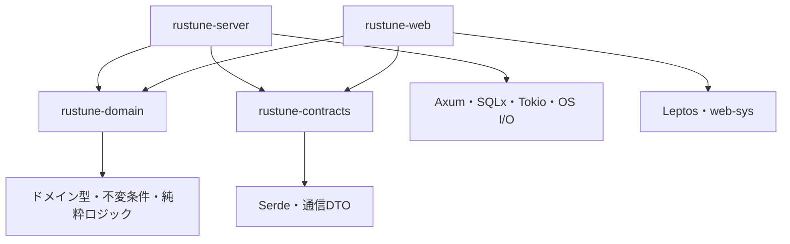
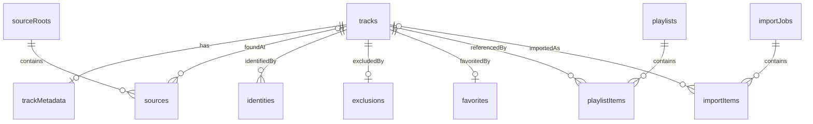
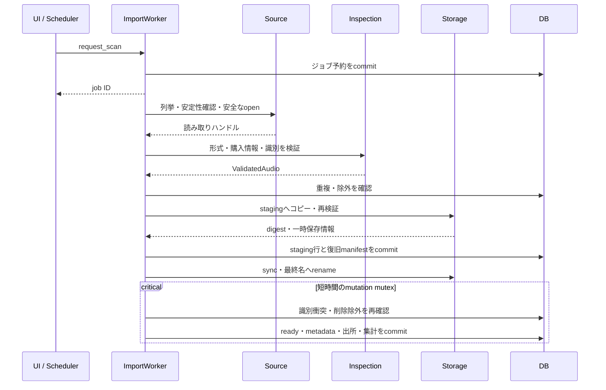
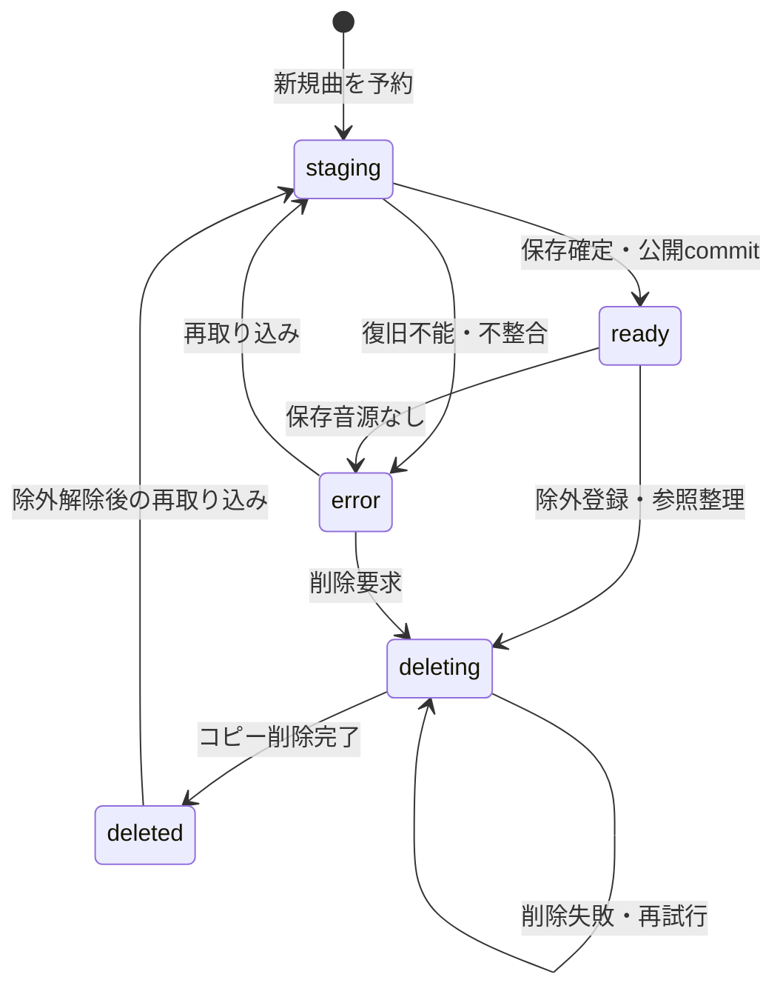
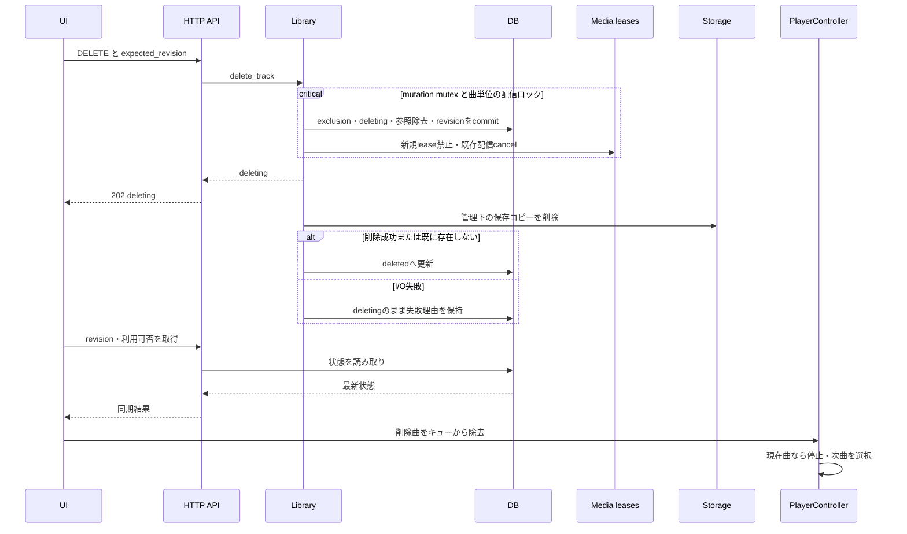
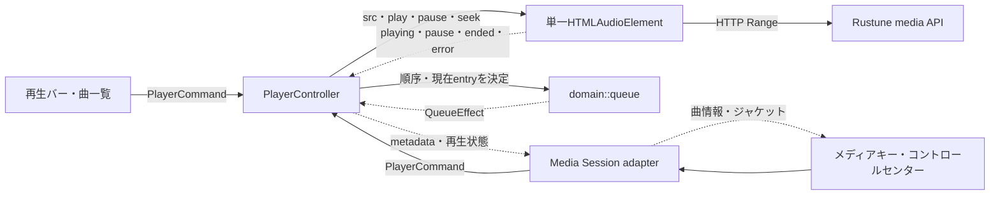

# Rustune — モジュール詳細設計

Status: Approved
Approved: 2026-10-16 by user
Last updated: 2026-10-17
Project: 20261012-214613-personal-music-library
PRD: ./PRD.md
Parent design: ./DESIGN_DOC.md

## 1. 位置付けと依存関係

承認済みPRDと全体設計を実装可能な単位へ具体化する設計案。以下の関数名・型名は公開境界を示す提案であり、まだ実装されていない。実装タスクの一覧ではない。iTunes購入曲のローカル取り込みを維持し、Spotify連携は追加しない。

依存方向は`server → domain`、`web → domain`、`server/web → contracts`。domainはOS・HTTP・SQL・Leptosを参照しない。contractsはSerdeとUUID等のデータ表現のみを持つ。境界でIDを変換し、DB行を直接Serializeしない。テストのためだけに全サービスをtrait化せず、ファイルI/O・時計・外部通信など障害注入が必要な境界だけ差し替え可能にする。

矢印は「参照する側 → 参照される側」のコンパイル依存を示す。webからserverへの通信はHTTPであり、クレート依存ではない。



| Module / 配置案 | 所有する責務 | 呼び出し先 |
| --- | --- | --- |
| contracts::{library,imports,settings,enrichment,error} | 公開DTO、入力制約、エラーcode | なし |
| domain::{track,identity,metadata,import_state,queue} | ドメイン型・不変条件と副作用のない判定・状態遷移 | なし |
| server::{bootstrap,config} | 起動、設定、終了、プロセスロック | db、recovery、import、http |
| server::db | SQL、migration、更新トランザクション | domain |
| server::source | root内の列挙と読み取り専用ハンドル | OSファイルAPI |
| server::inspection | AAC構造・購入情報の検証 | mp4ameta、domain::identity |
| server::storage | 一時保存、確定、削除、空き容量 | OSファイルAPI |
| server::import | スケジューラ、取り込みオーケストレーション | source、inspection、storage、db |
| server::library | 検索、編集、プレイリスト、削除・除外 | domain::metadata、db、storage |
| server::{artwork,enrichment} | 画像処理、候補取得と適用 | image、reqwest、db |
| server::{http,media} | API、HTTP境界、Range配信 | 各サービス、storage |
| server::recovery | 起動時のDB・ファイル照合 | db、storage |
| web::{api,sync,pages,shell} | 通信、画面データ、画面遷移 | contracts、Leptos |
| web::{player,media_session} | 再生、キュー、OS操作連携 | domain::queue、web-sys |

## 2. contracts — APIデータとエラー

IDはUUID文字列、時刻はUTCのRFC 3339、時間はミリ秒、サイズはバイト、revisionは非負整数としてJSONに出す。取り込み元の絶対パスは設定画面にだけ返し、楽曲・履歴ではroot名と相対パスを返す。購入者タグと保存先パスは公開DTOに定義しない。

主要DTO：

- `TrackSummary { id, title, artist, album, duration_ms, artwork_id, favorite, revision }`
- `TrackDetail { summary, album_artist, disc_number, track_number, sources, metadata_origins }`
- `Page<T> { items, total, offset, limit, library_revision }`
- `ImportJob { id, trigger, status, phase, total: Option<u64>, processed, added, skipped, failed, reason_counts }`
- `ImportItem { id, source_root_name, relative_path, status, reason, retryable, track_id }`
- `Playlist { id, name, revision, items: Vec<PlaylistItem> }`。itemは独自UUIDを持ち、同じ曲の複数追加を区別する。
- `ApiError { code, message, retryable, request_id }`。messageは日本語の定型文。OSやパーサーのエラー文字列をそのまま埋め込まない。

PATCHは各フィールドを`Keep / Set(value) / Clear`の3状態で表す。JSONで省略=Keep、値=Set、null=Clear。手動値のClearは取り込み値への復帰であり、空文字とは区別する。文字列はtrim後1〜512文字、プレイリスト名は1〜120文字、曲順・ディスク番号は1〜999。APIの文字数はUnicode scalar数で測定する。

| code例 | HTTP / 表示先 | 再試行方針 |
| --- | --- | --- |
| invalid_input / invalid_source_root | 400 | 入力修正 |
| not_found / media_missing | 404 | 再同期または再取り込み |
| revision_conflict / import_busy | 409 | 最新状態を読み直す |
| source_permission_denied / storage_full | ジョブ項目、必要ならAPIエラー | 原因解消後に再試行 |
| unsupported_codec / purchase_unverified | スキップ理由 | 内容変更まで自動再試行しない |
| file_unstable | スキップ理由 | 次の走査で再評価 |
| corrupt_audio | 失敗理由 | fingerprint変更または手動再試行 |
| interrupted / io_failure | ジョブまたは項目 | 復旧後に再試行 |
| upstream_unavailable / upstream_rate_limited | 502 / 503 | 待機して明示的に再試行 |

検証：DTO往復、3状態PATCH、未知のエラーcodeのUIフォールバック、購入者タグがSerialize対象に存在しないこと。

## 3. domain — ドメイン型・不変条件・純粋状態

`track`はTrackId、TrackState、Track、ValidatedAudio等のドメイン型と、その生成・遷移条件を所有する。フィールドを非公開にし、検証済みの入力からだけ生成する。ValidatedAudioの生成はdomainの検証コンストラクタを経由し、inspectionはコンテナ検査結果を渡す。OSのFileやHTTPの応答型をdomainへ持ち込まない。contractsのTrackSummaryやImportJobは通信専用DTOであり、domain型からserverで変換する。

### identity

`resolve_identity(verified_store_id, audio_digest) -> Vec<IdentityKey>`。ストアIDが検証できる場合も音声digestを併記する。digestはSHA-256で、バージョン付きの方式名を保存する。音声digestはデコーダ設定、各AACサンプルの長さとバイト列を順にハッシュし、タグ、ジャケット、コンテナoffsetを含めない。ファイル全体のdigestとは用途を分ける。

複数キーが異なる既存trackに一致した場合は自動統合せず`identity_conflict`。見つかった既存曲がdeleting/deletedなら取り込みを拒否する。アルバム違い・別録音をタイトル一致だけでまとめない。

### metadata

`resolve_metadata(imported, enriched, manual) -> EffectiveMetadata`と`normalize_search(text)`を持つ。表示優先順位は手動 > 明示適用した補完 > 埋め込み > ファイル名等の代替。補完を手動編集済みの項目へ明示適用した場合、その項目のmanualを解除することを確認画面で示す。適用トランザクションで解除と補完値更新を同時に行う。

Unicode NFKCと小文字化で検索列を生成する。ひらがな・カタカナや読み仮名の同一視は初期版の保証外。原表示は正規化しない。アルバム名・アルバムアーティストの手動変更時は旧ストアアルバムによるグループ固定を解除し、有効値からグループを再計算する。

### import_state

`transition(current, event) -> Result<NextState, InvalidTransition>`。ジョブの終端遷移は1回、項目の終端遷移も1回に限定し、再試行は新しいジョブ・項目として作る。時間やDB処理は呼び出し側で渡す。

### queue

`Queue { entries: Vec<QueueEntry>, current: Option<EntryId> }`。操作はReplaceAndSelect、Append、Next、Previous、RemoveTrack。同じtrackの複数出現をentry IDで区別する。末尾のNextは停止状態へ移り、先頭のPreviousは先頭を維持する。再生中の削除では次の利用可能なentryを選び、なければ停止する。再生API呼び出しは行わず、`QueueEffect`を返す。

検証：キー衝突、タグ差分digest、手動値維持、Unicode検索、キューの空・末尾・重複・削除。domainをnativeとwasm32の両方でコンパイルする。

## 4. bootstrap / config — 起動と設定

`load_config() -> RuntimeConfig`、`bootstrap() -> AppState`、`shutdown()`を公開境界とする。設定ファイルはbind先・port・保存先・ログ等の運用設定、DBは取り込みroot・auto_import・間隔・上限・storefront等のUI設定を所有する。同じ項目を両方に重複保存しない。

起動順：設定解析 → 保存先と権限確認 → 排他ロック取得 → SQLite接続・migration → recovery → localhost listener → ワーカー・scheduler起動。readyはrecovery完了後のみ返す。rootが存在しない・権限がない場合もHTTPは起動し、設定画面から修正できる。DBや保存先が使えない場合は起動失敗。

既定値：port=3867、auto_import=true、interval=60秒、stable_window=10秒、max_file=200 MiB、reserve_free=1 GiB、copy_concurrency=1。intervalの設定範囲は30〜3600秒、max_fileは1 MiB〜2 GiB、空き容量下限は1 GiB以上。値の不正を黙って既定値に置換しない。

SIGTERMでは新規ジョブ受付と定期予約を停止し、コピーは協調キャンセルして最大10秒待つ。終了に間に合わなかった処理は次の起動で復旧する。root変更は実行ジョブ中には409。変更時はsource root IDと設定revisionを更新し、過去の出所は保持する。auto_import無効化は新規自動予約だけを止め、実行中ジョブは完了させる。

検証：二重起動、port占有、設定不正、root不在時のUI起動、終了途中の再起動、設定変更競合。

## 5. db — 永続化とトランザクション

SQLxの具象Repositoryをサービスから使用する。接続pool上限4、busy timeout=5秒、WAL、foreign_keys=ON。重いファイル処理はトランザクションの外。DB行型はdbモジュール内に閉じる。

主要テーブルの制約：

| Table | 主キー・制約・索引 |
| --- | --- |
| tracks | id PK、state CHECK、media_path UNIQUE、revision、file_digest、audio_digest、size、duration、created_at。ready検索はstate索引 |
| track_metadata | track_id PK/FK、imported/enriched/manualの許可項目JSON、有効表示列、search_text、album_key、artist_key。JSON schema_versionを保持 |
| source_roots | id PK、サーバー内の絶対パス、display_name、active。現行rootは1つ |
| sources | (root_id, relative_path_bytes) UNIQUE、track_id nullable、device/inode/size/mtime、parser_version、outcome。OSパスは可逆なBLOB保存、UI表示は別途エスケープ |
| identities | (scheme, value) PK、track_id FK。track削除後も識別のため行を保持 |
| exclusions | track_id PK/FK、excluded_at。解除まで永続 |
| import_jobs | id PK、trigger、state、phase、各件数、settings_revision、開始・終了時刻。未完了jobが最大1件となるpartial UNIQUE索引 |
| import_items | id PK、job_id FK、source情報、state、reason、retryable、track_id nullable。job/state索引 |
| playlists | id PK、name、revision |
| playlist_items | id PK、playlist_id FK ON DELETE CASCADE、track_id FK、position。並べ替えは削除・再挿入を1トランザクションで行い、entry IDを維持 |
| favorites | track_id PK/FK |
| artworks | id PK、origin、path、width、height、digest、store_url nullable |
| library_state / settings | singleton PK、library_revision / settings_revision |

サービス用操作は`reserve_import`、`reserve_track`、`publish_track`、`begin_delete`、`finish_delete`、`apply_metadata`、`replace_playlist_items`等のユースケース単位。publish_trackはready変更・source関連付け・metadata・集計・library_revisionをまとめてcommitする。

楽曲・プレイリスト・設定の変更は`WHERE revision = expected`で更新し、0行なら409。お気に入りはPUT/DELETEで冪等とする。ライブラリの可視データ変更時にはグローバルrevisionも同じトランザクションで増やす。ジョブ進捗のみの変更は増やさない。

削除済みtracksには識別用の最小情報を残し、再取り込み成功時は同じtrack IDを再利用する。過去のプレイリスト・お気に入りは復元しない。履歴90日削除はjob/itemsに限定し、sources・identities・exclusionsを消さない。

主要な関連を示す。sourcesとimport_itemsのtrack参照は未判定・失敗時にはnullを許す。tracksの行は削除記録として残るため、音源削除はこの図の関連行すべての物理削除を意味しない。



検証：UNIQUE競合、FK違反、CAS競合、rollback、migration、新規・既存DB起動。SQL migrationファイルの実体は実装フェーズで追加する。

## 6. source — 走査とファイルアクセス

境界は`enumerate(root) -> CandidateStream`、`open_readonly(root, relative_path) -> OpenedSource`、`fingerprint(handle)`。OpenedSourceは読み取りハンドルと属性を所有し、絶対パス文字列を他モジュールの自由なopenに渡さない。

設定root自身と子のシンボリックリンクは拒否し、rootからdescriptor相対で各階層をno-followで開く。`..`、絶対パス、特殊ファイル、FIFO、socketを拒否する。最終ファイルだけでなく途中ディレクトリも検査する。元の内容は不変でもOSによるアクセス時刻更新はあり得るため、不変テストは内容・サイズ・mtimeを対象とする。

候補は`.m4a`と`.m4p`を大文字小文字を区別せず列挙。その他は対象外として拡張子別件数を表示し、全一般ファイルを履歴に複製しない。root配下の権限拒否は走査警告とし、結果を「全件確認済み」と表示しない。root全体を読めない場合はジョブ失敗。

保存先との包含・同一性は正規化したパス成分とファイル識別情報で検査する。検査後の差し替えに対して各openの属性を再確認する。

検証：外部リンク、途中階層の置換、特殊ファイル、Unicode・非UTF-8パス、アクセス拒否、元内容の不変。

## 7. inspection — 音源解析と識別

`inspect(read_seek, limits) -> InspectionResult`を用意する。結果は`Accepted(ValidatedAudio)`、`Deferred(reason)`、`Rejected(reason)`。ValidatedAudioはcodec情報、サンプル範囲、digest、許可メタデータ、画像候補、検証済み識別キーのみを含む。購入者タグの値を構造体へ持ち出さない。

処理順：ファイル長とbox境界検査 → トラック・sample entry → AACのデコーダ設定とサンプル参照 → 購入由来情報 → タグと画像 → digest。box個数・ネスト深さ・タグサイズ・サンプル数に上限を設け、整数加算とoffsetのoverflow、範囲外参照を拒否する。初期値は深さ32、box数10万、タグ領域16 MiB、サンプル数100万。上限を超える入力はクラッシュせず理由を返す。

mp4ametaはタグ読み取り用。購入済み判定の代替にはしない。形式検証アダプターの実装候補ライブラリは未選定であり、既存Rustパーサーで必要な情報が得られるかを最初に検証する。コンテナの独自パーサーを無条件に作る方針にはしない。保護情報を網羅的に調査する専用判定は実装せず、未対応codecは通常の形式エラー、ブラウザで再生できない場合はplayerの再生エラーとして扱う。

購入曲の判定規則とストアIDの取り出し方は実購入ファイルで確認するまで未確定。規則にはparser_versionを付け、更新時には判定不能だったsourceを再評価する。単なるAAC・ファイル名・アーティスト名は購入根拠にしない。正規購入曲を識別できない場合は要件の問題として戻し、すべてを除外したまま完成扱いにしない。

検証：購入AAC、同じファイルの別パスコピー、タグ違い、ALAC、CD AAC、途中・破損ファイル、壊れたbox長・sample offset。サンプルの構造検証は全AACフレームのデコード成功保証ではなく、再生エラーはplayerでも扱う。

## 8. storage / artwork — ファイル管理

storageの境界は`allocate_staging(track_id)`、`copy_checked(source, staged, limits)`、`promote(staged, final_path)`、`remove_managed(id)`。保存先は`staging/<uuid>.part`、`media/<uuid>.m4a`、`artwork/<uuid>.jpg`。利用者入力の曲名をパスに使わない。

コピーは固定サイズbufferで行い、200 MiB全体をメモリに載せない。開始前に予定サイズ+1 GiB、実行中に一定バイトごとの空き容量を確認する。実際の読み出しにもmax_fileを適用。元の開いたハンドルの属性と、root側のentryが同じファイルかをコピー前後に検査する。変化時はstagingを破棄しfile_unstable。

promotionは同じファイルシステム上のrename。stagingのflush/sync、rename、親ディレクトリ同期を行う。許可範囲外のパスを削除できるAPIは提供しない。ファイルが既にない場合の削除は成功として扱い、その他のI/O失敗は状態を保持する。

artworkの境界は`prepare_image(bytes, origin) -> StagedArtwork`。JPEG/PNGに限定し、入力10 MiB、展開16 megapixels、1画像処理を上限とする。表示用は最大512px・一覧用128px、元より拡大しない。EXIF等の付随情報は再エンコードで持ち越さない。API画像の加工可否は提供元の条件に従い、条件が認めない場合は再エンコード・縮小をせず提供サイズで保持する。埋め込み画像が壊れていても音源自体は取り込み、画像警告を残す。

画像promotionもtrackのready前に行い、失敗時は既定画像へフォールバックする。旧画像はDB参照がなくなったものだけcleanup。OS用ジャケットも同一originのartwork IDで返す。

検証：コピー失敗・容量競合・rename前後停止、元ファイル置換、画像bomb、巨大寸法、画像なし。コピー元の削除や匿名化は行わず、本人向け再生音源内の購入者タグの扱いは全体設計のレビュー事項を維持する。

## 9. import — 自動取り込みワーカー

`request_scan(trigger) -> JobId`、`run_job(job_id)`、`tick(now)`を境界とする。request_scanはDBでjobを予約してから通知channelへ送る。channel通知が失われてもワーカーがDBのqueuedを確認して開始できる。実行中は同じjob IDを返し、新しい手動操作を無限に積まない。

60秒ごとのschedulerと起動時走査はauto_import設定を確認する。列挙した候補のfingerprintを記録し、新規・変化したものは10秒後に再確認してからコピーする。待機は非同期で行いHTTPスレッドを占有しない。安定待ちで1ファイルずつ10秒待つ方式にはせず、候補を一括観測して期限到来後に処理する。

再走査の早期skipは「fingerprintとparser_version一致、紐付くtrackがready、保存音源が存在」に限る。missing sourceからRustuneの曲を自動削除しない。異なるパスの候補は解析して重複判定し、既存trackへ出所だけ追加する。コピー前の解析でduplicateが分かればコピーしない。未知のファイルはコピー後の再解析・digest照合で確定する。

| Item状態 | 意味 / 次の状態 |
| --- | --- |
| pending | 列挙済み。checkingへ |
| checking | 安定性・形式・識別確認。copyingまたはskipped/failedへ |
| copying | 一時コピー・公開準備。importedまたはskipped/failedへ |
| imported / skipped / failed | 終端。結果理由と再試行可否を保持 |

総数未確定中は`phase=enumerating,total=null`、確定後は`processing,total=N`。processedは終端項目数で、added+skipped+failedに一致させる。deferredは`skipped/file_unstable`としてその回を終了し、次回に再評価する。途中ダウンロード疑いは最初の安定観測から10分を超えた時点でcorrupt_audioへ移す。ファイルの変化で安定観測をリセットする。

容量不足で走査を打ち切った場合、未処理項目も`failed/storage_full`にし、jobはfailedとする。個別ファイルの失敗のみならjobはcompletedとし、UIは「完了・失敗N件」を表示する。単純な「成功」表示はしない。

publishと削除開始は同じ短時間のmutation mutexとDB制約で直列化する。コピー中はmutexを保持しない。最終公開時にidentitiesとexclusionsを再確認し、待機中に削除された曲を復活させない。二重予約はDB UNIQUEで検出して再照合する。

以下は新規の安定した音源を公開するまでの連携。重複・除外・失敗の枝は前述の状態と理由codeへ遷移する。rename前後に停止した場合は第10節のrecoveryが引き継ぐ。



検証：同時手動要求、設定無効化、起動中・停止中の追加、待機候補多数、削除との競合、progress集計一致。

## 10. recovery — 中断復旧

ワーカー開始前に実行する。runningのjobをinterruptedにし、非終端itemをfailed/interruptedへ更新する。queuedはDB上で保持し、復旧後に再利用できる。

| DB / ファイル状態 | 復旧操作 |
| --- | --- |
| track予約なし、一時ファイルのみ | アプリ管理下の孤立stagingを回収 |
| staging行、一時ファイルあり、最終ファイルなし | 検証済みmanifestとdigestを確認してpromotion可能なら続行。不一致なら破棄・error |
| staging行、最終ファイルあり | digest・サイズ・識別子・除外を再確認し、metadata等を同一transactionでreadyへ |
| staging行、どちらもなし | errorにして再取り込み対象へ |
| ready行、最終ファイルなし | error/media_missing、revision更新。sourceがあれば次の走査で再取得 |
| deleting行 | 保存コピーの削除を再試行し、完了したらdeletedへ |

予約行にはstaging名、最終名、期待digest、metadata、出所、job/item IDを復旧manifestとして持たせる。ファイルだけから元パスや購入者情報を推測しない。公開処理は冪等にし、復旧でreadyになっても元jobの中断記録を消さず、新しい走査では取り込み済みと判定する。ready行へ戻す際は他identityとの衝突も検査する。

DBにない最終音源は直ちに消さず、管理下のquarantineへ移し、修復警告を残す。起動時のdigest検証はstagingと不整合の対象に限り、毎回全曲を読み直さない。

曲の永続状態を示す。errorは再生不可、deletedは保存コピーを削除済みで識別記録を保持する状態。除外解除だけでreadyには戻らず、再走査・検証・コピーを経由する。



検証：予約commit、rename、ready commitの前後停止、破損manifest、missing音源、削除途中。recoveryを2回実行しても結果が変わらないこと。

## 11. library — 検索・編集・プレイリスト・削除

境界は`list_tracks(query)`、`get_track(id)`、`edit_track(id, patch, revision)`、`replace_playlist_items(...)`、`delete_track(id)`、`restore_import_eligibility(id)`。

一覧はreadyのみ。検索語は正規化後最大256文字、SQLのLIKE特殊文字をescapeしてパラメーター化。ORDER BYは列挙したsortだけ許可し、最後にIDを付ける。limit=50既定・最大100、offset最大100万。count・一覧・library_revisionは同一read transactionから返す。

アルバム・アーティストの一覧と詳細も同じ有効metadataを利用。グループキーはstore IDまたは正規化した表示キーのversion付きdigestで生成する。編集でグループ移動したら一覧を再同期し、旧詳細画面は「移動または削除」と案内する。

プレイリスト更新はentry ID、track ID、全順序、expected_revisionを受け、同じentry IDの重複・未知entry・readyでないtrackを拒否する。削除と同一transaction順序で整合させ、削除されたtrackのentryは除去してplaylist revisionも増やす。

曲削除はまずexclusionを登録してdeletingへ移し、参照除去とrevision更新をcommit。mediaの新規leaseを禁止・既存leaseをcancelしてからコピーを削除する。失敗時はdeletingのまま再DELETEを許可する。status取得はdeleting/deletedも返す専用DTOを使う。除外解除はdeleting中には409、deleted後にのみ許可し、再走査を予約する。

サーバー側の配信停止と、ブラウザ側のキュー同期は別の処理として示す。既にブラウザが受信した音声データはサーバーから回収できない。



検証：LIKE文字、日本語、ページング、編集保持、グループ移動、プレイリスト重複曲、revision競合、削除と追加の競合。

## 12. media / http — HTTP境界と音声配信

routerはsecurity middleware → DTO validation → service → response変換の順。AppStateはpoolと各サービスhandleを共有し、巨大な全体mutexを設けない。

### API補足

全体設計の`/api/v1`を次の契約で補う。

| Endpoint | Request / Response |
| --- | --- |
| GET /session | CSRF token、library_revision、server_instance_id。Cache-Control: no-store |
| GET /state | library_revision、現行job ID、最終走査、次回予定。UI同期用 |
| GET /tracks/:id/status | ready/deleting/deleted/error、reason、revision |
| GET /albums/:key、GET /artists/:key | group情報とページングした曲 |
| POST /playlists | name → 201、playlist |
| GET/PATCH/DELETE /playlists/:id | 取得、name+expected_revision、revision付き削除 |
| PUT /playlists/:id/items | entriesとexpected_revision → 更新済みplaylist |
| DELETE /tracks/:id | expected_revisionをJSON bodyで指定。202、idとdeleting状態 |

media URLは`/api/v1/media/:track_id`、画像は`/api/v1/artwork/:artwork_id`へ統一する。音源一覧から任意URLを指定させない。DBのready確認とlease登録をtrack単位のロックで行い、削除処理と原子的に直列化する。Response bodyの終了・dropでleaseを解放し、削除開始時には送信をcancelできるbody wrapperを使う。

最初はtower-httpのRange処理を再利用し、lease wrapperとの組み合わせを検証する。Range解析を独自実装する場合も、bytes単一範囲、suffix、終端省略、範囲外416を契約テストで固定する。multi-rangeはmultipart対応せず、仕様上許されるRange無視の200応答とする。HEADにbodyを載せない。正常配信はContent-Type: audio/mp4、Content-Length、Accept-Ranges: bytes、206時Content-Range。Cache-Control: private, no-storeとし、ブラウザ内部の既受信データまで削除できるとは保証しない。

Hostは設定portのlocalhost/127.0.0.1/[::1]だけを許可し、転送ヘッダーを信頼しない。UI originはlocalhostへ統一。読み取りGETは同一originのOriginがあれば検証し、Originがない通常のaudio要求も許可する。Sec-Fetch-Siteがcross-siteなら拒否。変更要求はOrigin完全一致とX-CSRF-Tokenの両方を必須とする。tokenは起動ごとに生成、ログに出さず、再起動時はUIがsessionを再取得する。CORSは開放しない。

検証：Range/HEAD/416/multi-range、削除との競合、DBとmediaの不一致、Originなし再生、cross-site変更拒否、APIの404にSPA HTMLを返さないこと。

## 13. enrichment — 候補検索と適用

`search_candidates(target, query, storefront)`と`apply_candidate(target, candidate_id, fields, revision)`を分離する。queryはタイトル等の許可項目から作り、元パス・購入者情報を外部へ送らない。storefront既定はJP。ネットワークはサーバーだけが行う。

外部応答は許可項目へ変換し、候補をサーバーメモリに10分・最大100件保持。candidate IDをUIへ返し、適用時に任意URLや任意JSONを受け取らない。期限切れはcandidate_expiredとして再検索を案内する。全呼び出しで3.1秒以上空け、待機中リクエスト数を最大5に制限する。429ではRetry-Afterを尊重し、自動無限retryしない。

画像は返されたartworkUrl100を優先、なければ60。数値を書き換えない。候補に画像がない場合は画像を変更しない。取得不能時は適用全体を失敗させて既存値を保持し、画像項目を外して再適用できる。画像取得と検証はDB transaction外、保存promotion後にrevision照合と選択項目をcommitする。競合でcommitできなければ孤立画像をcleanupする。

外部host許可・redirect・IP検査は専用fetcherに閉じる。候補表示にはストアリンクと必要な出典表示を付ける。利用条件の確認と購入者タグの扱いは全体設計の未確定事項を維持する。

検証：候補期限切れ、画像なし、低解像度、429、timeout、任意URL拒否、手動編集競合、画像失敗でのrollback。

## 14. web::{api,sync,pages,shell} — 画面と同期

ApiClientは型付き関数と共通エラー表示を持つ。読み取り通信は10秒timeout。変更要求のtimeoutは「未完了」ではなく「結果不明」とし、状態をGETで確認してから再操作する。CSRF更新だけを理由に非冪等POSTを自動再送しない。

QueryStateは`Idle/Loading/Ready/Empty/Error`。検索は250ms debounce、要求ごとのgenerationを付け、古い応答が新しい結果を上書きしない。編集formはserver revisionとdirty値を分離し、同期で入力途中の値を消さない。409では再読込と編集内容の確認を促す。

SyncServiceは取り込み中2秒・通常15秒で/stateを取得し、revision変更時に表示中のqueryを再取得する。visibility復帰時は即時同期。再生キューに含むtrackの利用可否も再検証し、readyでなくなった曲を除去する。サーバー切断時は表示データを残して接続状態を出し、1/2/4/8/15秒の上限付き再接続を行う。

ルート：`/library`、`/albums/:key`、`/artists/:key`、`/playlists/:id`、`/favorites`、`/imports`、`/settings`、`/exclusions`。全画面で共通navigationと再生バーを維持する。空ライブラリから取り込み設定・スキャンへ進める。リンク・ボタン・dialogのフォーカス移動を定義し、並べ替えはdragだけでなく上下ボタンも提供する。

document.titleは再生中なら「曲名 — Rustune」、それ以外は「画面名 — Rustune」。外部リンクは検証済みURLを通常ブラウザへ開く挙動をChrome実機で確認する。インストール名・アイコンはHTML headの固定情報を使い、Manifestは追加しない。

検証：古い検索応答、編集途中の同期、切断・復帰、ウィンドウ狭幅、全画面のキーボード操作。

## 15. web::{player,media_session} — 再生とOS操作

PlayerControllerはAppShellの生存期間中1つだけ作り、audio要素・イベントlistener・Media Session handlerを所有する。Route componentは所有しない。ブラウザAPIのClosureはcontrollerが保持し、dispose時に解除する。

`dispatch(PlayerCommand)`を唯一の操作口とし、UI・OS操作・endedのすべてを通す。状態は`Idle/Loading/Playing/Paused/Ended/Error`、付随値はcurrent_entry、position_ms、duration_ms、volume、load_generation、error。

| 入力 | 状態更新と副作用 |
| --- | --- |
| PlayEntry | generation増加、旧再生pause、src変更、load、必要ならplay Promise待機 |
| play Promise成功 / playing event | 同じgeneration・current sourceの場合だけPlaying |
| Pause | audio.pause、pause eventでPaused |
| Seek | durationの範囲へclamp。metadata未確定なら読み込み後まで保留 |
| Next / Previous | domain::queueでentry選択。選択先があれば読み込み、なければ停止 |
| ended | 現在sourceの終了ならNext。末尾はEnded |
| error | current sourceに対応するエラーのみ反映し、自動で全曲を飛ばし続けない |
| RemoveTrack | domainで参照除去。現在曲なら停止・次のentryへ |

load_generationは非同期の詳細取得・play Promiseに適用する。DOMイベントはgenerationを含まないため、src/currentSrc、load完了状態を照合し、旧sourceの遅延イベントを採用しない。ユーザーが急速に曲を切り替えても最後の選択だけを反映する。

Media Session metadataはreadyな曲情報だけ、playbackStateは実audio状態から更新。position stateは対応環境でduration有限の時だけ設定する。機能検出し、未対応のhandler登録例外はUI再生を止めない。Chromeでplay/pause/previous/nextを必須検証する。音量は0〜1へclampし、キューはこのウィンドウ内だけに保持する。

操作の入口はPlayerControllerへ集約する。キューの純粋ロジック、実際の音声状態、OS表示の役割を分ける。破線はイベントまたは状態の通知。



検証：ページ移動、素早い曲変更、play拒否、load中pause、末尾終了、現在曲削除、メディアキー、背景ウィンドウ、Safari/Firefoxの通常操作。

## 16. 運用・品質チェック

LaunchAgentはユーザーログインで起動し、絶対パスのバイナリとconfigを渡す。異常終了時だけ再起動、間隔10秒。実際のplistと設定・解除手順は実装時に追加し、インストールだけでMusicフォルダや起動設定を自動変更しない。配布資産とDB migrationを同じリリースにまとめ、更新前バックアップから戻せる構成とする。

フォーマットはrustfmt、LintはClippyを採用。workspaceの製品crate名は`rustune-domain`、`rustune-contracts`、`rustune-server`、`rustune-web`とし、CIではnativeとWASMを分ける。

```sh
cargo fmt --all -- --check
cargo clippy -p rustune-domain -p rustune-contracts -p rustune-server --all-targets -- -D warnings
cargo clippy -p rustune-web --target wasm32-unknown-unknown -- -D warnings
cargo test -p rustune-domain -p rustune-contracts -p rustune-server
```

上記は実装後の予定コマンドであり、現時点ではCargo workspaceは未作成。WASMのブラウザテストとTrunk release buildは別checkで実行し、通常のcargo testだけで再生やDOM操作が検証できたとは扱わない。

## 17. 要件対応と未確定点

| Requirement | 詳細設計節 | 検証 |
| --- | --- | --- |
| REQ-001 | 6–9 | 元不変・独立コピー・UI終了後継続 |
| REQ-002 | 2、9、14 | 件数・理由・途中状態表示 |
| REQ-003 | 8–10 | 各commit/rename境界停止・冪等復旧 |
| REQ-004 | 3、5、7、9 | 再スキャン・同じファイルの別パスコピー・ID衝突 |
| REQ-005 | 3、5、8、11 | メタデータ欠落・編集・再走査 |
| REQ-006 | 11、14 | 部分一致・グループ・空状態 |
| REQ-007 | 12、15 | Range・シーク・画面移動 |
| REQ-008 | 3、15 | 順序・重複entry・終了 |
| REQ-009 | 5、11、14 | revision・並べ替え・再起動 |
| REQ-010 | 5、11 | 冪等更新・永続化 |
| REQ-011 | 9–12、15 | 削除競合・lease解除・除外復元 |
| REQ-012 | 6–9、14 | 破損・形式・容量・再生失敗表示 |
| REQ-013 | 8、13 | 候補・低解像度・API失敗・既存保持 |
| REQ-014 | 4、9 | 自動有効/無効・起動・安定待ち |
| REQ-015 | 14、16 | Chromeインストール・title・navigation |
| REQ-016 | 15 | Macメディア操作実機 |
| REQ-017 | 4、16 | ログイン・異常終了・解除 |
| NFR-001 | 1、4–13 | Rustサーバーのビルドとレビュー |
| NFR-002 | 1、14–16 | WASMビルド・Rust UI・ブラウザテスト |
| NFR-003 | 5、9、11、14 | 1万曲・取り込み中の検索p95 |
| NFR-004 | 12、15 | 再生開始p95・Range |
| NFR-005 | 5、8、10、16 | 元移動後再生・停止バックアップ復元 |
| NFR-006 | 6、8 | root境界・差し替え・内容不変 |
| NFR-007 | 4、7–9、13 | 各制限・画像・レート境界 |
| NFR-008 | 4、12、16 | loopback・Origin・運用手順 |
| NFR-009 | 14、15 | 3ブラウザ・2幅・キーボード |
| NFR-010 | 2、6–8、13 | 許可DTO・ログ・外部通信に購入者値がないこと |

未確定なのは購入曲の判定規則と形式検証ライブラリ、ManifestなしのChrome挙動、API画像の利用条件、本人向け音源内タグの扱い。設計書を詳細化してもこれらは実証済みにはならない。必要な実機検証は全体設計のTesting strategyを維持し、不成立なら該当設計・要件へ戻す。
