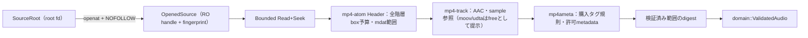

# 06: 安全な走査と音源解析

Status: In Progress
Project: 20261012-214613-personal-music-library
Requirements: REQ-004, REQ-005, REQ-012, NFR-006, NFR-010
Depends on: 02, 04
Parallel group: B

## Objective

設定rootだけを読み、対応する購入AACから検証済み情報を取得する。

## Design references

MODULE_DESIGN §6・7、02の検証結果。プロジェクトの承認済みPRD・DESIGN_DOC・MODULE_DESIGNを前提とする。

## Scope

### Included

以下の実装手順と検証を含む。

### Excluded

ファイルコピー・DB更新・自動予約。

## Expected code areas

crates/server/src/source/、inspection/、専用fixture・テスト

## Implementation steps

1. descriptor相対・no-followの列挙とread-onlyハンドル、fingerprintを実装する。
2. 02で選んだパーサーを境界内に実装し、AAC・購入情報・サンプル範囲を検証する。
3. 各解析上限、音声digest、許可メタデータ、parser_versionを実装する。
4. Deferred/Rejectedの理由を契約codeへ変換し、購入者タグやOS生エラーを外へ出さない。

## Verification

- 外部symlink、途中ディレクトリ差し替え、特殊ファイル、非UTF-8パスをテストする。
- 02の判定fixture、box長・sample offset・上限値をテストする。
- 元内容・サイズ・mtimeが変わらないことを確認する。

検証コマンドの未指定部分は実装したテスト名に合わせて具体化し、実行結果・環境をこのファイルへ追記する。上記は予定であり、現在の合格結果ではない。

## Acceptance criteria

未対応形式・破損・判定不能を理由付きで除外し、購入AACをValidatedAudioへ変換できる。

## Handoff notes

- 前提タスクの成果と検証記録を確認してから着手する。未解決の設計変更は該当承認ゲートへ戻す。
- 予定領域外の変更、共有Cargo設定・router・migrationへの変更が必要なら統合担当へ集約し、並行タスクの所有範囲を侵さない。
- UI変更時はdesign.mdを全文読み、依存関係・連携を変更したらMermaid図も更新する。
- 完了時にStatusをDoneへ更新し、変更ファイル、検証結果、未解決事項を記録する。購入音源・購入者情報はコミットしない。

## 実装・検証記録（2026-10-18）

中断したCodexの未コミット作業（source/・inspection/）をレビューして引き継ぎ、仕上げた。StatusはIn Progressのまま。Doneへの更新は統合担当が行う。

### 実装内容

- `server::source`：設定rootを`O_DIRECTORY|O_NOFOLLOW`で開き、以降は各階層を`openat`+no-followで辿る。`..`・絶対パス・シンボリックリンク（root自身・途中階層・最終ファイル）・FIFO・socket・デバイスを拒否。`.m4a`/`.m4p`を大文字小文字を区別せず列挙し、その他は拡張子別件数のみ（種類数128で上限）。配下の権限拒否・差し替えは警告とし`complete=false`。root自体を読めない場合のみ`Err`。`Fingerprint`（device・inode・size・mtime・ctime）、`open_candidate`による列挙時属性との照合、コピー前後用の`verify_entry`を用意。パスはバイト列のまま扱う。
- `server::inspection`：`inspect(read_seek, limits)`と、ハンドル属性を前後で照合する`inspect_source`。mp4-atom 0.15.0のHeaderで全階層のbox数予算（10万）・深さ（32）・親範囲・overflow・top-level mdat範囲・moov 16 MiBを検査 → mp4-track 0.1.0でAACトラック・ASC・sample参照（単一mdat payload内、description 1のみ、sample 1 MiB、100万件）→ mp4ameta 0.13.0で`itunes-tag-pattern-v1`と許可メタデータ・画像候補1件 → 購入規則一致後に検証済み範囲だけを読んで`rustune-aac-probe-v1` digest。ファイル上限200 MiB。上限付き`Bounded` Read+Seekで各パーサーのseek/readをファイル長内に制限。
- 理由の契約code変換：`Reason::error_code()`/`SourceError::error_code()`が`rustune_contracts::error::ErrorCode`を返す。購入者タグの値・OSやパーサーの生エラーは保持しない。

| 内部理由 | 結果 | 契約code | 再試行 |
| --- | --- | --- | --- |
| ReadFailed | Deferred | io_failure | 可 |
| SourceChanged | Deferred | file_unstable | 可 |
| InvalidContainer（破損・途中・範囲外） | Rejected | corrupt_audio | 可（fingerprint変更時） |
| UnsupportedCodec（ALAC・fragmented・複数音声等） | Rejected | unsupported_codec | 不可 |
| AnalysisLimit | Rejected | unsupported_codec | 不可 |
| PurchaseUnverified | Rejected | purchase_unverified | 不可 |
| source: InvalidPath / RootUnavailable / PermissionDenied | — | invalid_input / invalid_source_root / source_permission_denied | — |
| source: NotFound・NotRegular・Changed / Io・LimitExceeded | — | file_unstable / io_failure | — |

### 設計との差異・補足

- 契約に解析上限専用のcodeがないため、`AnalysisLimit`は`unsupported_codec`へ変換した（内部Reasonでは区別を保持）。
- mp4-track 0.1.0はmoov/udta内のタグも厳格に解析し、同一item内の複数data（複数ジャケット・重複タグ）を構造エラーにする。タグはmp4ameta の担当のため、Boundedリーダーがmp4-trackへ渡す読み出しに限りmoov直下udtaのfourccを`free`に見せる（元ファイルは変更しない）。
- mp4ameta 0.13.0はQuickTime形式（version/flagsなし）の`meta`を読めない。構造検査は通過させ、`purchase_unverified`として除外する。
- digestは購入規則一致後に計算し、非購入ファイルのsampleは読まない（MODULE_DESIGN §7の処理順に合わせた）。
- APFSは不正なUTF-8のファイル名を作成できないため、実際の非UTF-8 entryの列挙テストはLinuxのみ実行（`#[cfg(target_os = "linux")]`）。macOSではパス成分の無損失処理を検証。

### 検証結果（macOS / Rust 1.99.1、mainへrebase後）

- `cargo fmt --all -- --check`：成功
- `cargo clippy --locked -p rustune-domain -p rustune-contracts -p rustune-server --all-targets -- -D warnings`：成功
- `cargo test --locked -p rustune-domain -p rustune-contracts -p rustune-server`：server 26件成功・1件ignored（実音源opt-in）、contracts 6件、domain 7件成功
- `cargo clippy --locked -p rustune-web --target wasm32-unknown-unknown -- -D warnings`：成功
- 実音源（`.local/audio-testing.md`の指定ファイル1件、読み取り専用）：`RUSTUNE_AUDIO_TEST_FILE=<指定ファイル> cargo test --locked -p rustune-server --lib inspection::tests::authorized_local_audio_is_accepted -- --ignored`で1件成功。実行前後でサイズ・mtime・SHA-256が一致。購入者値・パスは出力・記録していない。

主なテスト：外部symlink・途中ディレクトリのsymlink差し替え・FIFO/socket・`..`/絶対パス・権限拒否サブディレクトリ・非UTF-8成分・open後の差し替え検出（source）。購入AAC受理、CD相当AAC・タグ不足/空白/1025 bytes/重複/非文字列/zero・異長cnID、ALAC相当entry、version 1 sound description、fragmented、空・途中・trailing bytes・box長（小さすぎ・EOF超・子の親超過・64-bit overflow）、mdat外/EOF外sample offset・sample長、各上限（ファイル・moov・sample・sample数・box数・深さ・全階層共有予算）、タグ変更でdigest不変・packet相違でdigest相違、digest方式の再計算一致、元ファイル内容・サイズ・mtime不変（inspection）。

### 変更ファイル

`crates/server/src/lib.rs`（mod行2行）、`crates/server/src/source/{mod.rs,tests.rs}`、`crates/server/src/inspection/{mod.rs,bounds.rs,tests.rs}`、本記録。

### 未解決事項

- 解析上限超過の専用契約codeを追加するかは04/統合担当で判断（現状`unsupported_codec`）。
- 埋め込み画像は1件目のバイト列を候補として渡すのみ。10 MiB上限・形式検証は07（artwork）が担う。
- 全AACフレームのデコード成功は保証しない。実音源は指定1件のみで、全購入曲の網羅性は未検証。
- `verify_entry`・`ScanReport`の取り込みワーカーへの接続は09の担当。
