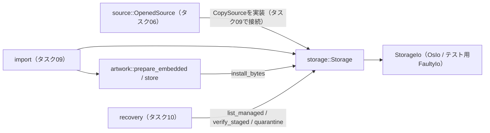

# 07: 音源保存とジャケット処理

Status: Planned
Project: 20261012-214613-personal-music-library
Requirements: REQ-001, REQ-005, REQ-012, NFR-005, NFR-007
Depends on: 04
Parallel group: B

## Objective

元を変更しない独立コピーと、確定・回収可能な一時保存を実装する。

## Design references

MODULE_DESIGN §8。プロジェクトの承認済みPRD・DESIGN_DOC・MODULE_DESIGNを前提とする。

## Scope

### Included

以下の実装手順と検証を含む。

### Excluded

DB transaction、ジョブ管理、外部画像取得。

## Expected code areas

crates/server/src/storage/、artwork/、専用I/O・画像テスト

## Implementation steps

1. UUIDベースの保存先、staging、固定bufferコピー、digest、元ファイル変化の検査を実装する。
2. 予定サイズと空き容量下限、コピー中上限、sync/rename/親ディレクトリ同期を実装する。
3. 管理下ファイルだけの削除とquarantine移動を実装する。
4. 埋め込み画像の制限付きデコード、サムネイル、壊れた画像のフォールバックを実装する。

## Verification

- コピー・sync・rename・削除の障害注入、容量競合、元ファイル変更をテストする。
- JPEG/PNG、画像なし、巨大寸法・圧縮画像・破損画像を検証する。

検証コマンドの未指定部分は実装したテスト名に合わせて具体化し、実行結果・環境をこのファイルへ追記する。上記は予定であり、現在の合格結果ではない。

## Acceptance criteria

部分コピーが完成音源として扱われず、元の移動後も管理下コピーを利用できる。

## Handoff notes

- 前提タスクの成果と検証記録を確認してから着手する。未解決の設計変更は該当承認ゲートへ戻す。
- 予定領域外の変更、共有Cargo設定・router・migrationへの変更が必要なら統合担当へ集約し、並行タスクの所有範囲を侵さない。
- UI変更時はdesign.mdを全文読み、依存関係・連携を変更したらMermaid図も更新する。
- 完了時にStatusをDoneへ更新し、変更ファイル、検証結果、未解決事項を記録する。購入音源・購入者情報はコミットしない。

## 実装・検証記録（2026-10-18、ブランチ`task07-storage-artwork`）

### 変更ファイル

- `crates/server/src/lib.rs`：`pub mod artwork;`・`pub mod storage;`の2行のみ追加。
- `crates/server/src/storage/mod.rs`：`Storage`、`ManagedFile`、`CopyLimits`、`StagedFile`、`MediaFile`、`StorageError`等。
- `crates/server/src/storage/io.rs`：障害注入用の`StorageIo`境界と`OsIo`（statvfs・F_FULLFSYNC相当のsync・置換なしrename・ディレクトリfsync）。
- `crates/server/src/storage/source.rs`：コピー元の入力境界`CopySource`・`SourceSnapshot`と簡易実装`FileSource`。
- `crates/server/src/artwork/mod.rs`：`prepare_image`、`prepare_embedded`、`store`、`remove`。
- `crates/server/tests/{storage.rs,artwork.rs,support/mod.rs}`：合成データだけを使う統合テスト。

### 公開境界と連携

storageは取り込み元のパスを受け取らず、`CopySource`（`Read + Seek`、開いたハンドルの属性、root側エントリを辿り直した属性）だけを受け取る。タスク06の`OpenedSource`へ`CopySource`を実装すれば、タスク09でそのまま接続できる。

### 手順ごとの実装内容

1. `allocate_staging(track_id)`は新しいUUIDで`staging/<uuid>.part`を0600・排他作成する。最終名は`media/<track uuid>.m4a`。`copy_checked`は固定buffer（既定256 KiB）でコピーし、SHA-256を同時に計算する。コピー前後に元ハンドルとroot側エントリの属性（device・inode・size・mtime・ctime）を照合し、変化・差し替え・削除・読み出し量とサイズの不一致は`file_unstable`。失敗・キャンセル時はstagingを削除する。
2. 開始前に「予定サイズ + 空き容量下限」、コピー中は`space_check_interval`ごとに「残り + 下限」を確認する。`max_file`は属性と実際の読み出し量の両方に適用する。`promote`はサイズ確認 → staging sync → 置換なしrename → media・stagingの親ディレクトリsync。
3. `remove_managed`・`quarantine`は`ManagedFile`（UUIDからのみパスを生成）だけを受け付け、任意パスを扱うAPIはない。既にない場合の削除は成功、その他の失敗はエラーを返す。`list_managed`は正規の名前の通常ファイルだけを列挙する。
4. JPEG/PNGをマジックナンバーで判定し、入力10 MiB・展開16MPをヘッダー読み取り直後に検査してから画素を展開する（デコーダのメモリ上限160 MiB、プロセス内で1画像ずつ直列化）。表示用512px・一覧用128pxへ縦横比を保って縮小し拡大しない。JPEGへ再エンコードし、EXIF等を持ち越さない。画像なしは`Absent`、壊れた画像は`Fallback`（警告code`artwork_invalid`等）で音源の取り込みは継続できる。

### 検証コマンドと結果

環境：macOS 27.0.1（arm64）、rustc 1.99.1。worktree `/Users/yk/dev/rustune/.local/worktrees/task07`、mainの`1f5f6a6`上。

| コマンド | 結果 |
| --- | --- |
| `cargo fmt --all -- --check` | 成功 |
| `cargo clippy --locked -p rustune-domain -p rustune-contracts -p rustune-server --all-targets -- -D warnings` | 成功（警告なし） |
| `cargo test --locked -p rustune-domain -p rustune-contracts -p rustune-server` | 成功：storage 20件、artwork 12件、既存server 2件、domain 7件、contracts 6件 |
| `cargo clippy --locked -p rustune-web --target wasm32-unknown-unknown -- -D warnings` | 成功 |

主な検証テスト（`crates/server/tests/`）：

- コピー・確定と元の移動：`copy_and_promote_keep_playable_copy_after_source_moves`（元の内容・サイズ・mtime不変、元の移動・削除後も管理下コピーを読める、0700/0600）。
- 障害注入：`partial_write_failure_leaves_no_staging_or_media`、`partial_staging_survives_only_as_part_when_cleanup_also_fails`、`sync_failure_discards_staging`、`rename_failure_keeps_staging_and_can_be_retried_after_verification`、`directory_sync_failure_after_rename_is_reported_with_final_file_present`、`remove_managed_is_idempotent_and_keeps_state_on_failure`。
- 容量：`space_precheck_requires_planned_size_plus_reserve`（境界値ちょうどは成功、1バイト不足で`storage_full`）、`space_shrinking_during_copy_aborts_and_cleans_up`。
- 元ファイル変化：`source_modified_during_copy_is_unstable`、`source_entry_replaced_or_removed_after_open_is_unstable`、`size_limit_applies_before_and_during_copy`。
- 管理範囲：`remove_managed_only_touches_managed_names`、`quarantine_moves_unreferenced_media_out_of_media_dir`、`open_rejects_symlinked_or_file_subdirectories`、`promote_never_replaces_existing_media`、`corrupted_staging_is_rejected_by_verification_and_promotion`。
- 画像：`jpeg_is_downscaled_for_display_and_thumbnail_keeping_aspect`、`small_png_with_alpha_is_not_upscaled`、`missing_image_is_absent_not_an_error`、`huge_png_dimensions_are_rejected_from_header_only`、`huge_jpeg_dimensions_are_rejected`、`highly_compressed_png_bomb_is_rejected_before_allocating_pixels`（4100x4100を数十KBに圧縮したPNG）、`corrupt_images_fall_back_with_warning`、`reencoding_drops_exif_metadata`、`store_failure_leaves_no_partial_artwork`。

実音源は使用していない（すべてテスト内で合成）。

### 設計との差異

- stagingファイル名はtrack IDではなく試行ごとの新しいUUID（`staging/<uuid>.part`）。再試行や回収前の残骸と衝突させないため。最終名は設計どおり`media/<track uuid>.m4a`。
- ジャケットは`artwork/<uuid>.jpg`（表示用）に加え一覧用`artwork/<uuid>.thumb.jpg`を保存する。加工不可の補完画像は提供バイト列のまま保持するため、PNGの場合は`.png`になる。
- `promote`は`promote(staged, final_path)`ではなく`promote(&StagedFile)`とし、最終パスはtrack IDから内部で決める（呼び出し側に任意パスを渡させない）。
- `copy_checked`には協調キャンセル用の`&AtomicBool`を追加した（SIGTERM時の最大10秒待ちに使う）。

### 未解決事項

- サイズ超過の理由code`file_too_large`は`contracts::error::ErrorCode`に未定義。storageは文字列として返す。contractsへの追加要否は統合（タスク09）で判断する。画像警告code（`artwork_invalid`・`artwork_too_large`・`artwork_unsupported`）も同様。
- `CopySource`のタスク06`OpenedSource`への実装、DB manifestへの`staging_id`・digest（16進）の保存、`artworks`行への登録はタスク09・10で行う。
- Statusの更新は統合担当が行う。
