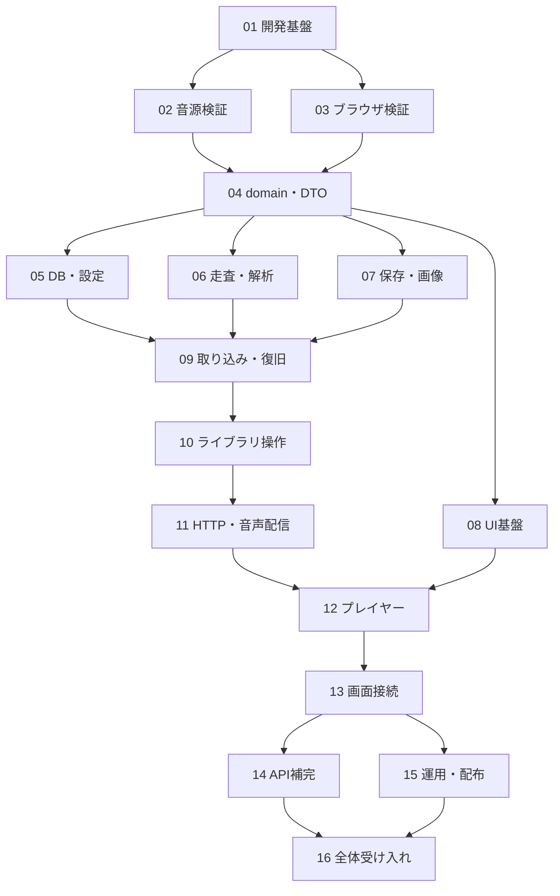

# Implementation Plan

Status: Draft
Last updated: 2026-10-16
Project: 20261012-214613-personal-music-library
Design: ../DESIGN_DOC.md
Module design: ../MODULE_DESIGN.md

## Delivery strategy

ユーザーが16タスクの粒度と依存順に合意したため詳細化した計画。合意はタスク構成への承認であり、この詳細計画全体の承認とは分ける。実装は詳細計画承認後に開始する。

購入音源・ブラウザの成立性を先行検証し、共通型を固め、取り込み・管理・配信を実装する。その後WASM画面を接続して運用・受け入れを完成させる。UIはルートdesign.mdとAGENTS.mdを遵守する。ShouldのREQ-010/REQ-013も計画へ含め、延期は明示レビューする。

## Execution order

| Order | Task | Depends on | Parallel group | Requirements |
| --- | --- | --- | --- | --- |
| 01 | [開発基盤とCI](01_workspace_foundations.md) | None | None | NFR-001, NFR-002 |
| 02 | [購入音源の識別・重複防止の検証](02_audio_feasibility.md) | 01 | A | REQ-004, REQ-012, NFR-010 |
| 03 | [Chromeインストール・再生・OS操作の検証](03_browser_feasibility.md) | 01 | A | REQ-007, REQ-015, REQ-016 |
| 04 | [ドメインモデルとAPI DTO](04_domain_and_contracts.md) | 02, 03 | None | REQ-004, REQ-005, REQ-008, NFR-001, NFR-002, NFR-010 |
| 05 | [SQLite・設定・起動基盤](05_persistence_and_bootstrap.md) | 04 | B | REQ-005, REQ-009, REQ-010, REQ-011, NFR-005, NFR-008 |
| 06 | [安全な走査と音源解析](06_source_and_inspection.md) | 02, 04 | B | REQ-004, REQ-005, REQ-012, NFR-006, NFR-010 |
| 07 | [音源保存とジャケット処理](07_storage_and_artwork.md) | 04 | B | REQ-001, REQ-005, REQ-012, NFR-005, NFR-007 |
| 08 | [デザイン準拠のUI基盤](08_ui_foundations.md) | 03, 04 | B | REQ-015, NFR-002, NFR-009 |
| 09 | [取り込みジョブ・自動走査・復旧](09_import_and_recovery.md) | 05, 06, 07 | None | REQ-001, REQ-002, REQ-003, REQ-004, REQ-012, REQ-014, NFR-003, NFR-005, NFR-006, NFR-007 |
| 10 | [ライブラリ操作・削除・除外](10_library_management.md) | 09 | None | REQ-005, REQ-006, REQ-009, REQ-010, REQ-011, NFR-003, NFR-005 |
| 11 | [API・音声配信・サーバー統合](11_http_and_media.md) | 10 | None | REQ-001, REQ-002, REQ-005, REQ-006, REQ-007, REQ-009, REQ-010, REQ-011, REQ-014, NFR-004, NFR-008, NFR-010 |
| 12 | [WASMプレイヤーとOSメディア操作](12_player_and_media_session.md) | 08, 11 | None | REQ-007, REQ-008, REQ-016, NFR-002, NFR-004 |
| 13 | [各画面のAPI接続と同期](13_screens_and_sync.md) | 12 | None | REQ-001, REQ-002, REQ-005, REQ-006, REQ-009, REQ-010, REQ-011, REQ-014, REQ-015, NFR-002, NFR-009 |
| 14 | [iTunesメタデータ・ジャケット補完](14_itunes_enrichment.md) | 13 | C | REQ-013, NFR-007, NFR-010 |
| 15 | [自動起動・配布・復元・ログ運用](15_operations_and_release.md) | 13 | C | REQ-017, NFR-005, NFR-008, NFR-010 |
| 16 | [全体受け入れと初期版の完成判定](16_release_acceptance.md) | 14, 15 | None | REQ-001〜REQ-017、NFR-001〜NFR-010 |

番号は統合順。同じparallel groupでも、依存が完了してから着手する。

## Parallel ownership

現時点の他のSmartpowersプロジェクトはなし。実装着手時に再確認する。並行グループは実行可能な候補であり、今すぐエージェントを起動する指示ではない。

| Group | Tasks | 所有分離 |
| --- | --- | --- |
| A | 02、03 | experiments/audioとexperiments/browser、検証記録を分離 |
| B | 05、06、07、08 | db/config/bootstrap、source/inspection、storage/artwork、web共通部品を分離。domain/contracts変更は04へ集約 |
| C | 14、15 | enrichmentと補完画面、配布・運用・ログ処理を分離。共通router/起動・Cargo変更は統合担当が順次反映 |

Cargo.toml・Cargo.lock、共通router、migration番号、全体CSS・AppShellは同時編集しない。migrationは05を起点に後続タスクへ順次引き継ぐ。09・10はDB操作が重なるため直列。14の補完ルート登録と15の起動処理統合も共通entrypointの変更を直列化する。

## Integration checkpoints

1. 01: native/WASMのビルド・Lint・最小起動が通る。
2. 02/03: 購入判定、再ダウンロード同一性、Chromeインストール・AAC・OS操作が実証される。不成立は設計へ戻し、未検証を完了としない。
3. 04: domain/DTO境界が固まり、後続並行実装の契約になる。
4. 09: 手動・自動取り込み、再走査、各commit境界での復旧を統合確認。
5. 11: 実APIから取り込み・検索・管理・Range配信を操作できる。
6. 13: 音源追加から検索・編集・プレイリスト・連続再生までUIで通る。
7. 16: 全Must/NFR、Shouldの完了または承認済み延期、性能・復元・実機操作の結果が揃う。

## Plan risks

- 02には実購入AACと再ダウンロード版、03/15/16には実Mac・実ブラウザが必要。着手時に利用可能性を確認し、無断購入や個人ファイル探索をしない。
- 購入曲の判定規則・検証パーサーは02で確定する。失敗した場合の要件緩和を事前に仮定しない。
- 14の画像は低解像度を許容するが用途条件の確認は残る。不成立ならShould延期・変更を明示する。
- 本人向け再生音源の購入者タグは承認済み設計どおり保持し、管理DTO・画面・ログ・外部送信から除外する。
- ChromeのManifestなし挙動が不成立なら、黙ってPWAやネイティブ構成へ変更しない。
- サーバー停止時のバックアップと復元にはLaunchAgentの再起動抑止も含める。元Musicライブラリを復元作業の対象にしない。
- 完了予定日や所要日数は現段階で見積もらず、先行検証の結果に応じて残作業を調整する。

## Review status

タスク構成・依存順は合意済み。PLAN.mdと個別タスクの詳細はDraftとしてレビュー待ち。現時点ではコード実装・検証実行・OS起動設定変更は行っていない。
