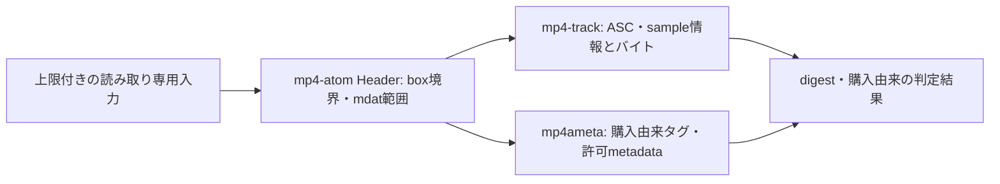

# 音源解析の成立性検証（タスク02）

2026-10-18、現行要件の限定検証を完了した。指定された購入AAC 1件で解析・購入由来タグの取得・別パスコピーとタグ編集後の同一性を確認した。製品の自動走査・保存・本番inspectionアダプターはタスク06以降の担当。

元ファイルは読み取り専用で開き、フォルダ走査・元ファイル更新・外部送信をしない。実音源のコピーはprivateな自動削除一時ファイルのみ、タグ編集はメモリ内だけで行った。購入者値、元パス、曲名、生パーサーエラーは出力・記録しない。音源と端末固有パスはGit・CIへ持ち込まない。この端末の指定はGit管理対象外の`.local/audio-testing.md`を参照。

## 再現コマンド

```bash
cargo test --manifest-path experiments/audio/Cargo.toml --locked
cargo fmt --manifest-path experiments/audio/Cargo.toml -- --check
cargo clippy --manifest-path experiments/audio/Cargo.toml --all-targets --locked -- -D warnings
```

明示的に指定されたローカルファイルの診断：

```bash
cargo run --manifest-path experiments/audio/Cargo.toml --locked -- '/explicit/authorized/file.m4a'
```

実音源のタグ差分・別パスコピー試験は通常テストから除外している。端末で指定ファイルを`RUSTUNE_AUDIO_TEST_FILE`に設定した場合のみ、次のコマンドを使う。環境変数やテスト出力をCIへ転用しない。

```bash
cargo test --manifest-path experiments/audio/Cargo.toml --locked \
  tests::authorized_local_audio_tag_and_copy_variants -- --ignored --exact
```

## 採用候補と役割

| ライブラリ | 調査した能力 | 今回の選択 |
| --- | --- | --- |
| [mp4ameta 0.13.0](https://docs.rs/mp4ameta/0.13.0/mp4ameta/) | iTunesタグ、Fourcc指定データ、メモリ内タグ編集 | 許可メタデータと購入由来タグのアダプターに採用。単独で形式・購入判定はしない |
| [mp4-track 0.1.0](https://docs.rs/mp4-track/0.1.0/mp4_track/) | Limits、ASC、sample offset/size、description_index、writer | AAC構造とsample取得の候補として選択。合成データと指定実AACで成立を確認 |
| [mp4-atom 0.15.0](https://docs.rs/mp4-atom/0.15.0/mp4_atom/struct.Header.html) | Headerの既存デコーダ、box payload長 | 同じ依存系列のHeaderを用い、top-level境界とmdat payload範囲を検査する薄いアダプターに採用 |
| [mp4 0.14.0](https://docs.rs/mp4/0.14.0/mp4/struct.Mp4Reader.html) | track、sample数、sampleバイト取得 | 公開APIに必要な入力上限の一括指定がなく、今回は選択しない |
| [mp4parse 0.17.0](https://docs.rs/mp4parse/0.17.0/mp4parse/) | read_mp4、sample table解析 | 配布ソースも確認。今回必要なsample読み出し・設定可能な上限の組合せではmp4-trackが直接的。未使用依存としては残さない |

mp4-trackは新しいライブラリで、全入力の正しさやAACフレームの全デコード成功を保証したという意味ではない。依存バージョンを固定し、タスク06へこの実験と限界を引き継ぐ。独自のAAC/MP4 sample tableパーサーは実装していない。



## 購入由来の判定規則

規則名を`itunes-tag-pattern-v1`とする。構造検査済みのAACについて、次をすべて満たす場合に`purchase_evidence = matched_tag_pattern`、不足・異常は`missing_or_invalid`とする。

- `purd`（購入日時）と`apID`（アカウント）は、それぞれ1個の非空文字列、各1024 bytes以下。空白のみ、非文字列、重複を採用しない。内容の値は結果へ持ち出さない。
- `cnID`は1個の4-byte big-endian、非zeroのストア楽曲ID。異長・重複・zeroは採用しない。数値のstore IDのみ結果へ返せる。
- 単なるAAC、ファイル名、タイトル、アーティスト、拡張子だけでは判定しない。

指定実購入ファイルでは、この組合せとAACの解析が成立した。通常のタグなしAACはこの規則に一致せず、CD由来AACを購入曲として扱わない。タグは書き換え可能で、合成タグでも一致するため、所有権・ストア照合・暗号学的真正性の証明ではない。個人用取り込み元から購入曲を選別するローカル規則として扱う。将来規則を更新したらparser/rule versionを変え、判定不能だったsourceを再評価する。

保護情報の専用調査と、ストアから同一曲を再取得して比較する要件は2026-10-17のユーザー指示で対象外になった。未対応entryは通常の形式エラー/unsupported、再生失敗はplayerで扱う。これらをタスク02の追加試料待ちにはしない。

## 同一性の規則と後続への注意

`rustune-aac-probe-v1`は、scheme prefix、8-byte big-endian長付きASC、各sampleの8-byte長とバイト列を順番にSHA-256へ入力する。タイトル、購入者情報、ジャケット、container offsetは含めない。sample境界を長さで区切るので、同じ連結バイトでもpacket分割が異なれば別digestになる。

同じdigestは同じ符号化音声として重複扱いにできる。store IDは補助キーとして保持する。タイトルだけで統合せず、同じstore IDでもdigestが違えば識別衝突として扱う必要があることを合成試験で確認した。本実験はidentityを出力するだけでDB統合を実装しないため、既存設計のresolve_identity・一意制約の衝突処理は04/09で明示する。異音声の黙った上書きは避ける。再エンコード済みの同録音を統合する音響fingerprintではない。実再ダウンロード版の同一性は要求対象外で、保証しない。

## 形式検査と上限

実験はfile全体64 MiB、moov 16 MiB、sample 1 MiB、sample数100万、深さ32、fragment数0を上限とする。64 MiBまでメモリへ読み、top-level Headerを既存ライブラリでデコードして、加算overflow・EOF超過・短いheader・不正box長・top-level box数10万超過を拒否する。sampleのoffset/sizeがファイル内にあるだけでなく、単一mdat payloadに収まることも検証する。Header自体やftyp/moovを音声sampleとして参照するファイルは拒否する。

mp4-trackは最初のsample descriptionだけを公開するため、別descriptionを参照するsampleを拒否する。ASCが空、非AAC、空sample、範囲外sample、fragmented入力は採用しない。unknown boxはパーサーのwarningになり得るが、生のwarningは出力せず件数だけ返す。全フレームのデコード・聴音の保証ではない。

製品06への適用方針：本実験のメモリ全読み・64 MiB制限をそのまま製品仕様とはしない。上限付きRead+Seek上の既存Headerアダプターで、payloadを不要に確保せず境界・mdat範囲を確認してからmp4-trackへ渡す。metadataはmoov以下16 MiB制約で先に予算を確認する。設計のbox総数10万は**全階層**に適用する必要があり、実験のtop-levelだけのカウントとは区別する。既存Headerの階層予算アダプターと、mp4-trackの深さ/sample上限の組合せは06で実装・検証する。本番の形式検査完成とは報告しない。

## 判定表と結果

| 入力・比較 | 検証結果 | 試料と限界 |
| --- | --- | --- |
| 購入AAC | 解析・購入由来規則に一致、digest取得成功 | 指定実ファイル1件。全購入曲の網羅性は未検証 |
| 同一ファイルと別パスコピー | digest/store ID一致 | 指定実ファイルのprivate一時コピー。自動削除 |
| タイトル変更 | digest/store ID一致、購入由来規則を保持 | 指定実ファイルをメモリ内だけで編集 |
| タグ/handler長/offset変更 | digest不変 | 合成fixture。架空購入者タグの変更も含む |
| CD相当AAC | AACと解析するが購入由来規則に不一致 | タグなし合成fixture。CD実ファイルは使っていない |
| ALAC等の未対応entry | AAC扱いせず解析拒否またはunsupported | 合成entry。実ALAC decode試験ではない |
| 空、破損header、途中、不正box長、trailing bytes | 静的エラーで拒否 | 合成fixture |
| sample offsetがEOF外/mdat外 | 拒否 | 合成fixture |
| タイトル/store ID一致、音声packet相違 | digest相違、異音声のまま識別可能 | 合成fixture。タイトル・store IDだけで自動統合しない |
| タグ不足・zero/異長store ID・空白/重複account | 購入由来規則に不一致 | 合成タグ |
| 実再ダウンロード比較 | 未実施・保証なし | 現行要件の対象外 |

2026-10-18 macOS / Rust 1.99.1で、合成テスト12件成功・ローカル専用1件は通常実行から除外。ローカル専用テストを指定実音源で明示実行し1件成功。fmt --check、Clippy --all-targets --locked -- -D warnings成功。合成packetは構造/digest試験用で、AACデコード音源ではない。
