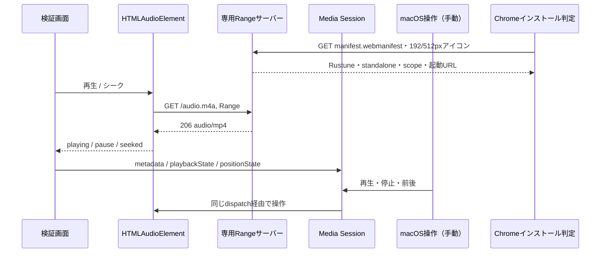

# ブラウザ成立性検証

製品とは独立したNode製の短命な検証ハーネス。正式なサーバー・プレイヤーはRustで実装する。インストール用の最小Web App Manifestを使い、Service Worker・オフライン再生・外部音源は使わない。既定のテスト音は小さな440Hzの音なので音量に注意する。明示指定した実音源による端末内の自動検証にも対応する。

```sh
node experiments/browser/generate-fixture.mjs
node --test experiments/browser/server.test.mjs
node experiments/browser/server.mjs
```

`http://127.0.0.1:4317`を開く。初回コマンドはmacOSの`afconvert`が必要。合成PCMから12秒のAACを生成し、必要ならmoovを末尾へ移してstco/co64のchunk offsetを補正する。出力した`fixtures/tone.m4a`はgitignore対象。WAV中間ファイルは生成処理で削除する。

自動検証は任意の既存Playwrightインストールを利用する（ランタイムの依存ではない）。Chromeは新しい一時プロファイルを使う。

```sh
# この開発環境に用意済みのPlaywrightを使う
node experiments/browser/browser-check.mjs
# 別環境では既に導入したPlaywrightのindex.mjsを指定する
PLAYWRIGHT_PATH=/absolute/path/to/playwright/index.mjs node experiments/browser/browser-check.mjs
```

`CHROME_PATH`でChrome実行ファイルを変更できる。自動テストは空きポートで専用サーバーを起動・終了する。Range対応とブラウザ再生の証拠を標準出力へ出す。OSメディアキー、インストール、Dock、通常ブラウザへの外部リンクの引き渡しは自動テストの合格に含めない。

Manifestは`name/short_name: Rustune`、`id/start_url/scope: /`、`display: standalone`、背景・テーマはCSSの`--bg`と同じ`#121212`。自作の`icon.svg`からローカルChromeで192px/512px PNGを生成した。再生成は同じ`PLAYWRIGHT_PATH`を指定して`node experiments/browser/generate-icons.mjs`を実行する。HTTPテストはManifestの配信type・情報・CSS色との一致・PNG実寸を確認する。

ブラウザ自動検証は一時的な通常プロファイルを作成・削除し、CDPの`Page.getAppManifest`と`Page.getInstallabilityErrors`がエラーなしであること、Service Worker登録がないことを確認する。これはインストール可能性の静的検査で、アドレスバーのinstallアイコン表示・実インストール成功を保証しない。表示にはブラウザ状態や利用状況・既存インストールも影響するため、実画面で別途確認する。

手動確認用のChromeを開く場合は、下記を**明示的に**実行する。起動すると専用サーバーと新しい一時プロファイルのChromeだけを開く。個人プロファイル・ログイン・システム設定を変更しない。デフォルト4317ポートは`PORT`で変更可能。

```sh
PLAYWRIGHT_PATH=/absolute/path/to/playwright/index.mjs node experiments/browser/manual-check.mjs
```

Dockからの再表示テスト中はこのプロセスを残す。完了時はCtrl+Cで終了し、サーバー・ブラウザ・作成した一時プロファイルを片付ける。手動でOSへテストアプリをインストールした場合は、プロファイルを片付ける前にそのテストアプリを自分で削除する。ランナーはOSアプリをインストール・削除しない。手動インストール結果の永続利用を目的としたプロファイルではない。

端末内で指定済みの実音源を検証する場合、`.local/audio-testing.md`のファイルを`RUSTUNE_TEST_AUDIO`環境変数に指定して`browser-check.mjs`を実行する。元ファイルは読み取り専用で、コピーしない。CIでは実音源指定を拒否する。ページからのリクエストはローカル検証サーバーの同一originだけに限定する。ファイル名や購入者タグは結果に出さず、画面とMedia Sessionはダミー名を使用する。既定のCLIサーバーとHTTPテストは引き続き合成音源を使用する。

`manual-check.mjs`も同じ指定に対応するが、実音源使用時は外部リンクを含む同一origin外のページリクエストをブロックする。外部リンクの引き渡し確認は合成音源モードで行う。



## 実機の手動チェックリスト

実施者・日付・macOS版・ブラウザ版・操作手順・実際の結果を記録する。「未実施」と「不合格」を区別する。製品の390px/1280px受け入れは後続UIタスクで行う。このページの配色等はdesign.mdに合わせるが、検証専用の一列構成でsidebar/常設プレイヤーは省略する。

| 操作 | 期待する結果 | 現在の結果 |
| --- | --- | --- |
| Chromeでページを開きinstallアイコンまたはメニューからアプリとしてインストールする | 最小Manifestで名称Rustune、アイコン、独立ウィンドウを確認する。使用した導線も記録 | 2026-10-18 ユーザーが追加・更新成功を報告。導線・表示詳細の個別確認は未実施 |
| 起動アイコン・Dockから閉じた後に再表示 | 正しいページを表示し、名称が保たれる | 未実施 |
| インストールしたウィンドウで外部リンクを開く | 通常ブラウザへ遷移し、プレイヤーウィンドウが置換されない | 未実施 |
| 末尾moovの合成AACを再生、6秒へシーク | 音声が聞こえ、待機後に指定位置から再開 | 自動検証成功／聴音未実施 |
| Macメディアキーの再生・停止 | 実audio状態と画面・OS表示が同期 | 未実施 |
| Macメディアキーの前・次 | 合成テスト1/2とOSの曲名が同期 | 未実施 |
| コントロールセンターで再生・停止・前・次 | 同じ操作が成立し、曲名・位置を表示する（表示の差異も記録） | 未実施 |
| 別ウィンドウを前面にしてメディアキー操作 | バックグラウンドのRustuneが操作される | 未実施 |
| セッション解除後にOS表示を見る | 音声停止・メタデータ解除。残留表示があれば記録 | JS状態のみ自動成功／OS表示未実施 |
| Safariで再生・停止・シーク | 基本再生が成立。対応するOS操作と差異も記録 | 未実施 |
| Firefoxで再生・停止・シーク | 基本再生が成立。対応するOS操作と差異も記録 | 未実施 |

合成テスト1/2は同じ音源を使うダミーキューで、正式なキューや連続再生の保証ではない。Media Sessionハンドラー登録成功はOSが操作を配送する証明ではない。製品のRust/WASMとの接続、購入ファイル固有の形式差、サーバー停止・削除競合などは後続タスクで検証する。

インストールやChromeの前後操作が成立しない場合、要件REQ-015/REQ-016と設計へ戻す。2026-10-18のユーザー承認で最小Manifestを採用した。Service Worker・オフライン・別フレームワークは暗黙に追加しない。
